## Índice

- [0. Ficha del proyecto](#0-ficha-del-proyecto)
   - [0.1. Tu nombre completo](#01-tu-nombre-completo)
   - [0.2. Nombre del proyecto](#02-nombre-del-proyecto)
   - [0.3. Descripción breve del proyecto](#03-descripción-breve-del-proyecto)
   - [0.4. URL del proyecto](#04-url-del-proyecto)
   - [0.5. URL o archivo comprimido del repositorio](#05-url-o-archivo-comprimido-del-repositorio)
- [1. Descripción general del producto](#1-descripción-general-del-producto)
   - [1.1. Objetivo](#11-objetivo)
   - [1.2. Características y funcionalidades principales](#12-características-y-funcionalidades-principales)
   - [1.3. Diseño y experiencia de usuario](#13-diseño-y-experiencia-de-usuario)
   - [1.4. Instrucciones de instalación](#14-instrucciones-de-instalación)
- [2. Arquitectura del Sistema](#2-arquitectura-del-sistema)
   - [2.1. Diagrama de arquitectura](#21-diagrama-de-arquitectura)
   - [2.2. Descripción de componentes principales](#22-descripción-de-componentes-principales)
   - [2.3. Descripción de alto nivel del proyecto y estructura de ficheros](#23-descripción-de-alto-nivel-del-proyecto-y-estructura-de-ficheros)
   - [2.4. Infraestructura y despliegue](#24-infraestructura-y-despliegue)
   - [2.5. Seguridad](#25-seguridad)
   - [2.6. Tests](#26-tests)
- [3. Modelo de Datos](#3-modelo-de-datos)
   - [3.1. Diagrama del modelo de datos](#31-diagrama-del-modelo-de-datos)
   - [3.2. Descripción de entidades principales](#32-descripción-de-entidades-principales)
- [4. Especificación de la API](#4-especificación-de-la-api)
   - [Especificación OpenAPI](#especificación-openapi)
   - [Notas sobre cada endpoint](#notas-sobre-cada-endpoint)
- [5. Historias de Usuario](#5-historias-de-usuario)
   - [Historia de Usuario 1 — Armar una caja de regalo](#historia-de-usuario-1--armar-una-caja-de-regalo)
   - [Historia de Usuario 2 — Comprar sin cuenta con un checkout simple](#historia-de-usuario-2--comprar-sin-cuenta-con-un-checkout-simple)
   - [Historia de Usuario 3 — Publicar una página de producto desde el panel](#historia-de-usuario-3--publicar-una-página-de-producto-desde-el-panel)
- [6. Tickets de Trabajo](#6-tickets-de-trabajo)
   - [Ticket 1 — QB-12 · Tablas de pedidos y función crear_pedido()](#ticket-1--qb-12--tablas-de-pedidos-y-función-crear_pedido)
   - [Ticket 2 — QB-21 · Endpoint de confirmación de pagos con Payphone](#ticket-2--qb-21--endpoint-de-confirmación-de-pagos-con-payphone)
   - [Ticket 3 — QB-34 · Isla interactiva "Crea tu propia caja"](#ticket-3--qb-34--isla-interactiva-crea-tu-propia-caja)
- [7. Pull Requests](#7-pull-requests)
   - [Pull Request 1 — Tablas de pedidos y función crear_pedido()](#pull-request-1--tablas-de-pedidos-y-función-crear_pedido)
   - [Pull Request 2 — Endpoint de confirmación de pagos con Payphone](#pull-request-2--endpoint-de-confirmación-de-pagos-con-payphone)
   - [Pull Request 3 — Isla "Crea tu propia caja"](#pull-request-3--isla-crea-tu-propia-caja)

---
## 0. Ficha del proyecto

### **0.1. Tu nombre completo:**

Andrés Parra S.

### **0.2. Nombre del proyecto:**

**Quinde Blue — Tienda online de regalos personalizados**

### **0.3. Descripción breve del proyecto:**

Tienda online para **Quinde Blue**, marca ecuatoriana de regalos artesanales de diseño propio (cuadernos, álbumes, cajas de regalo y detalles en madera) hechos a mano en Quito. Hoy casi todas las ventas se cierran por chat en Instagram y WhatsApp, y una compra puede tardar semanas. La plataforma lleva ese proceso a la web: el cliente explora el catálogo, ve el producto en detalle, lo personaliza a partir de modelos base, o arma su propia caja de regalo con un configurador interactivo que calcula el precio al instante, y paga en línea. El contacto humano se mantiene, pero después de la compra y solo para afinar detalles. La tienda incluye además una base de clientes para fidelizar a los compradores recurrentes.

### **0.4. URL del proyecto:**

[https://github.com/aparrauio/QBtienda](https://github.com/aparrauio/QBtienda)

### 0.5. URL o archivo comprimido del repositorio

[https://github.com/aparrauio/QBtienda.git](https://github.com/aparrauio/QBtienda.git)

---

## 1. Descripción general del producto

**Quinde Blue** es una marca artesanal fundada y dirigida por **Gaby**, diseñadora, desde Quito (Ecuador). Vende productos hechos a mano y personalizados, con diseño propio: cuadernos, álbumes, cajas de regalo, marcapáginas y piezas en madera. Toda la fotografía y el video de producto son originales (no usa imágenes referenciales ni IA).

**Cómo se vende hoy** (según la entrevista con la dueña, octubre de 2026):

| Aspecto | Situación actual |
|---|---|
| Canal de captación | Instagram (@quinde.blue, ~9.700 seguidores) es el canal principal; algunas ventas llegan por recomendación. |
| Cierre de la venta | Por chat (Instagram y WhatsApp). La mayoría son compras largas: el cliente pregunta y negocia durante días o semanas antes de pagar. |
| Personalización | La mayoría de los clientes parte de un diseño existente y pide cambios. Algunos piden productos de otras tiendas, que la marca no hace. |
| Pagos | ~90 % por transferencia bancaria y el resto con tarjeta de crédito, coordinado por chat. |
| Envíos | Por Servientrega (operador externo). Una minoría retira el pedido en persona. Los datos de envío se piden por chat. |
| Datos de clientes | Hay un registro de nombres, productos comprados y ciudades, pero los teléfonos están dispersos en los chats de Instagram y WhatsApp. |
| Ventas por la web | Prácticamente nulas. |

**El problema central:** la dueña dedica demasiado tiempo a chats largos que alargan el ciclo de venta. A la vez, el cliente ecuatoriano desconfía de comprar solo con clics y necesita sentir que hay una persona detrás de la pantalla. El producto tiene que equilibrar las dos cosas: **automatizar la compra sin perder el trato humano.**

### **1.1. Objetivo:**

**Propósito.** Convertir la web en el canal principal de venta de Quinde Blue, de modo que el cliente pueda descubrir, personalizar y pagar un producto por su cuenta, y que la conversación con la marca pase a ser un acompañamiento posterior a la compra en lugar de un requisito para comprar.

**Qué soluciona:**

1. **Ciclos de venta largos.** Hoy un pedido puede tardar semanas en concretarse por chat. La tienda resuelve en la página las preguntas frecuentes (cómo es por dentro, qué materiales tiene, qué opciones hay) y permite pagar en el momento.
2. **Carga operativa de la dueña.** Reduce al mínimo la interacción necesaria antes del pago: datos de envío, método de pago y opciones de personalización se capturan en el checkout.
3. **Personalización sin límites.** Ordena la personalización en modelos base con opciones definidas, en lugar de diseños desde cero o pedidos que no son de la marca.
4. **Falta de datos de clientes.** Centraliza el historial de compras y los datos de contacto para hacer promociones y lanzamientos dirigidos.
5. **Desconfianza en la compra online.** Mantiene un canal humano visible (chat posterior a la compra, presencia de Gaby en la marca) para que el cliente sepa que le compra a una persona.

**Qué valor aporta:**

- **Para el cliente:** una compra clara, rápida y confiable de un regalo artesanal y personalizado, pudiendo explorar el producto en detalle antes de decidir. Además, puede armar su propia caja de regalo y ver el precio final al instante, sin pedir una cotización por chat.
- **Para la marca:** más ventas cerradas con menos tiempo de chat, una imagen profesional coherente con el posicionamiento "artesanal" (y no "manualidades") y una base de clientes que permite fidelizar.

**Para quién:**

- **Compradores (usuarios finales):** personas en Ecuador que buscan un regalo original, hecho a mano y con un toque personal. Llegan sobre todo desde Instagram o por recomendación.
- **Clientes recurrentes:** quienes ya compraron y a quienes la marca quiere fidelizar con promociones y lanzamientos exclusivos. La dueña prefiere clientes fijos a captar siempre clientes nuevos.
- **Administradora (Gaby):** gestiona el catálogo, los pedidos y la relación con los clientes.

**Personalidad de marca que el producto debe transmitir:** *artesanal, cálida y creativa.*

**Cómo se medirá el éxito (horizonte de 6 meses tras el lanzamiento):**

- Se cierran ventas directamente por la página web (hoy prácticamente no llegan por ahí).
- Aumentan las compras repetidas de clientes que ya compraron en la web.
- Baja el tiempo y el volumen de chat necesarios antes del pago.

### **1.2. Características y funcionalidades principales:**

Cada funcionalidad responde a una necesidad que salió en la entrevista. La prioridad indica qué entra en la primera versión (MVP).

| # | Funcionalidad | Necesidad que resuelve | Prioridad |
|---|---|---|---|
| F1 | Catálogo curado por categorías | "Que sea fácil encontrar lo que esté buscando, que tengan las categorías bien definidas." | MVP |
| F2 | Ficha de producto con información clara | "Que en la página esté toda muy clara la información." | MVP |
| F3 | Personalizador por modelos base | "Personalizar sí va, sí o sí", pero "no personalizar cada detalle". | MVP |
| F4 | Exploración interactiva del producto | Preguntas frecuentes como "¿cómo es por dentro el cuaderno?" | MVP (versión básica) |
| F5 | Carrito y pago en línea | "Que paguen por su lado." | MVP |
| F6 | Envío o retiro en el checkout | Los datos de envío hoy se piden por chat. | MVP |
| F7 | Chat posterior a la compra | "Que se realice la compra y después se haga un chat personal." | MVP |
| F8 | Base de clientes (mini CRM) | Teléfonos dispersos en los chats; deseo de clientes fijos. | MVP |
| F9 | Promociones y lanzamientos para la comunidad | "Tal vez lo de las promociones, sí." | Fase 2 |
| F10 | Panel de administración | Gestión autónoma de productos y pedidos. | MVP |
| F11 | Sección "Detrás de la marca" | Generar confianza ("una persona detrás de la pantalla"). | MVP |
| F12 | Crea tu propia caja de regalo | Las cajas de regalo hoy se cotizan pieza por pieza en el chat; Gaby quiere que "paguen por su lado". | MVP (varias cajas por pedido y tarjeta corporativa: fase 2) |
| — | Realidad aumentada | "No me suena tanto." | Fuera de alcance |

#### F1. Catálogo curado por categorías
- Catálogo acotado a **unos 20 productos** en **unas 4 categorías** (por ejemplo: cuadernos, álbumes, cajas de regalo, detalles en madera). La dueña considera que tiene demasiados productos y prefiere una selección.
- Navegación simple: inicio, categorías, producto. La información es suficiente sin saturar.
- Solo se publican productos propios de la marca. No se aceptan encargos de productos de otras tiendas.

#### F2. Ficha de producto con información clara
- Galería de fotos y videos propios (el contenido ya existe).
- Descripción, materiales, medidas, tiempos de elaboración y precio base.
- Bloque de preguntas frecuentes por producto, para responder en la página lo que hoy se pregunta por chat.

#### F3. Personalizador por modelos base
- Cada producto tiene entre **5 y 10 modelos base** sobre los que el cliente elige.
- Opciones configurables por producto: **color, nombre, texto, tipo de hojas, material y diseño**.
- No se ofrecen diseños desde cero: todo parte de diseños existentes, que es como compra la mayoría de los clientes.
- Vista previa del resultado y precio actualizado según las opciones elegidas.

#### F4. Exploración interactiva del producto
- Visor que permite "abrir" el producto: hojear el cuaderno, ver el tipo de hojas, ver el interior de un álbum o qué contiene una caja de regalo.
- Primera versión: secuencias de fotos o video interactivo. Versión posterior: visor 3D, que la dueña sí ve útil para el catálogo.
- **Realidad aumentada: fuera de alcance**, porque la dueña no la ve alineada con su marca.

#### F5. Carrito y pago en línea
- Carrito con los productos personalizados y su resumen de opciones.
- Métodos de pago: **transferencia bancaria** (con carga del comprobante o confirmación) y **tarjeta de crédito/débito** mediante una pasarela de pago.
- Confirmación del pedido con número de orden.

#### F6. Envío o retiro en el checkout
- El cliente elige **envío a domicilio** (Servientrega, todo Ecuador) o **retiro en persona**.
- Se capturan dirección, ciudad, teléfono y datos de quien recibe. Ya no hace falta pedirlos por chat.
- Estados del pedido visibles para el cliente: recibido, en elaboración, enviado o listo para retirar, entregado.

#### F7. Chat posterior a la compra
- Una vez pagado el pedido, un botón abre **WhatsApp** con un mensaje que ya incluye el número de orden, para afinar detalles con Gaby.
- Responde a la expectativa del cliente ecuatoriano de hablar con una persona sin bloquear la compra.
- Antes de comprar hay un acceso de contacto discreto para dudas puntuales, que no es el camino principal de compra.

#### F8. Base de clientes (mini CRM)
- Registro automático de cada comprador: nombre, contacto (teléfono y correo), ciudad, pedidos, fechas y montos.
- **Importación de la lista actual** de clientes (nombres, compras y ciudades) para no partir de cero.
- Historial de compras por cliente e identificación de clientes recurrentes.

#### F9. Promociones y lanzamientos para la comunidad (fase 2)
- Cupones y promociones personalizadas según el historial de compras.
- **Lanzamientos exclusivos** o acceso anticipado para los clientes más fieles.
- Apoyan el objetivo de recompra.

#### F10. Panel de administración
- Alta y edición de productos, modelos base y opciones de personalización.
- Gestión de pedidos y cambio de estados.
- Consulta de la base de clientes.
- Indicadores básicos: pedidos por la web, ingresos y clientes recurrentes.

#### F11. Sección "Detrás de la marca"
- Historia de Gaby y del proceso artesanal (taller, manos, materiales).
- Refuerza la confianza y la diferenciación. En Instagram, el contenido con la fundadora duplica la interacción del contenido de solo producto.

#### F12. Crea tu propia caja de regalo

El cliente arma una caja de regalo paso a paso: agrega productos, elige la caja y escribe la dedicatoria. La plataforma calcula el precio en tiempo real y pide solo los datos que corresponden a lo elegido.

**Referente funcional:** [Happy Box — Build a Box](https://happyboxstore.com/products/build-a-box), revisado el 20 de octubre de 2026. Su configurador tiene tres pasos (elegir regalos, elegir el diseño de la caja y escribir la tarjeta). Un panel lateral muestra la caja y un subtotal que se actualiza con cada pieza. Se pueden ajustar las cantidades y quitar productos, y un mismo pedido admite varias cajas. La tarjeta lleva un mensaje escrito a mano (con límite de caracteres), la firma de quien regala y la opción de enviarla en blanco. La tarjeta con logo para pedidos corporativos exige un pedido mínimo.

**Adaptación a Quinde Blue:**

| Paso | Qué hace el cliente | Qué hace la plataforma |
|---|---|---|
| **1. Elige tus productos** | Recorre los productos habilitados para caja, filtrados por ocasión (cumpleaños, Día del Maestro, Navidad, agradecimiento…), y los agrega con "Agregar a la caja". | Muestra el precio de cada pieza, permite ajustar cantidades o quitar productos y actualiza el subtotal. Controla la **capacidad de la caja**: indica los espacios ocupados y bloquea agregar más cuando la caja está llena. |
| **2. Personaliza las piezas** | En los productos que lo admiten (por ejemplo, un cuaderno o un marcapáginas), elige el modelo base y completa nombre, texto o color. | Pide **solo los campos** que cada pieza admite, aplica el recargo de personalización si existe y lo suma al subtotal. |
| **3. Elige la caja** | Elige el tamaño y el diseño de la caja (por ejemplo, kraft o madera grabada). | Suma el precio de la caja y ajusta la capacidad disponible según el tamaño. Si las piezas ya elegidas no caben, sugiere un tamaño mayor. |
| **4. Escribe la dedicatoria** | Elige el diseño de la tarjeta y escribe el mensaje (Gaby lo escribe a mano) y la firma, o la deja en blanco. | Valida el límite de caracteres y suma el precio de la tarjeta si tiene costo. |
| **5. Revisa y agrega al carrito** | Ve la vista previa de la caja con todo su contenido y el precio final. | Muestra el desglose (productos, personalizaciones, caja y tarjeta) y pasa la caja al carrito como una sola línea editable. Envío y pago siguen el checkout normal (F5 y F6). |

**Cálculo del precio:**

> **Precio de la caja armada** = precio de la caja + Σ (precio de cada producto × cantidad) + Σ recargos de personalización + precio de la tarjeta
>
> El costo de envío se calcula en el checkout según la ciudad, o es cero si el cliente elige retiro.

**Reglas de negocio:**

- Solo entran productos propios de Quinde Blue que la administradora marque como "habilitado para caja". Así se mantiene la regla de no hacer productos ajenos a la marca.
- Cada tamaño de caja tiene una capacidad máxima. Cada producto ocupa un número de espacios definido por la administradora.
- Puede definirse un número mínimo de piezas por caja para que el regalo no se vea vacío.
- La personalización sigue el mismo criterio que F3: modelos base con opciones cerradas, nunca diseños desde cero.
- Si un producto se agota, deja de mostrarse en el configurador.

**Datos que se solicitan:** solo los que exige lo elegido. Son los campos de personalización de cada pieza y el mensaje y la firma de la tarjeta. Opcionalmente, el nombre de quien recibe el regalo y una fecha deseada de entrega. Los datos de envío se piden una sola vez, en el checkout.

**Fase 2:**
- Varias cajas en un mismo pedido, cada una con su propio contenido y su propia dedicatoria.
- Tarjeta con el logo del cliente para **regalos corporativos**, con un pedido mínimo de cajas.
- **Cajas sugeridas** ya armadas por ocasión, que el cliente puede usar como punto de partida y modificar.

### **1.3. Diseño y experiencia de usuario:**

> **Nota:** esta entrega es solo documentación. Las capturas de pantalla, los mockups y el videotutorial se agregarán cuando exista el prototipo. Mientras tanto, esta sección define los principios de diseño y el recorrido del usuario.

#### Principios de diseño

| Principio | Qué significa en la interfaz |
|---|---|
| **Claridad** | Categorías bien definidas, poca información por pantalla y un camino de compra evidente. Que sea fácil encontrar lo que se busca. |
| **Calidez artesanal** | Fotografía con luz natural, texturas de madera y papel kraft, presencia de las manos y del taller. Tono cercano, en primera persona. |
| **Creatividad** | Una exploración del producto que sorprenda (abrir el cuaderno, sacar lo que hay en la caja), sin recurrir a efectos ajenos a la marca como la realidad aumentada. |
| **Profesional, no "manualidades"** | Estética cuidada y coherente que evite verse "barata". Paleta y tipografías consistentes con el logo, sin collages tipo plantilla. |
| **Persona detrás de la pantalla** | Gaby visible en la marca y un canal de contacto humano siempre a mano, sobre todo después de la compra. |
| **Contenido propio** | Solo fotos y videos originales de la marca. |

**Referente estético:** la dueña toma como referencia la identidad de una creadora que vende cursos online, por el manejo coherente de colores, energía y estilo en toda su página. **Lo que se quiere evitar:** marcas que se perciben como "manualidades" o de aspecto barato.

#### Recorrido del comprador

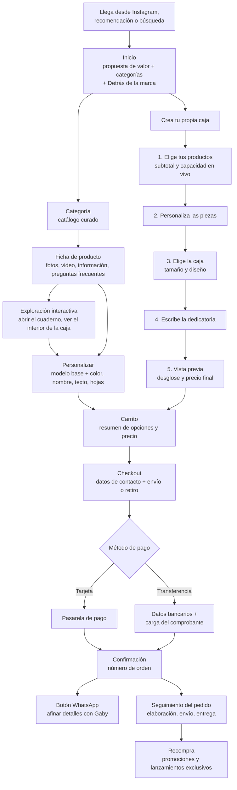

#### Pantalla por pantalla

1. **Inicio:** mensaje de marca (regalos de diseño propio, hechos a mano en Quito), acceso directo a las ~4 categorías y a **"Crea tu propia caja"**, productos destacados y un bloque breve "Detrás de la marca" con Gaby.
2. **Categoría:** cuadrícula limpia de productos con foto, nombre y precio base. Sin filtros complejos, porque el catálogo es pequeño.
3. **Ficha de producto:** galería de fotos y videos propios, descripción, materiales, tiempos de elaboración y preguntas frecuentes, con un llamado claro a "Personalizar".
4. **Exploración interactiva:** visor para hojear el cuaderno, ver el tipo de hojas o el interior de una caja de regalo. Responde antes de comprar las preguntas que hoy llegan por chat.
5. **Personalizador:** el usuario elige un modelo base y avanza por pasos (color, nombre o texto, tipo de hojas o material), con vista previa y precio actualizado.
6. **Crea tu propia caja:** un configurador por pasos con un indicador de avance ("Paso 2 de 5"). Un **panel fijo** muestra la caja en construcción: miniaturas de las piezas, control de cantidad, botón para quitar, espacios usados y **subtotal en vivo**. En el celular, ese panel se convierte en una barra inferior desplegable con el subtotal y el botón "Siguiente". El último paso muestra la vista previa con el desglose del precio antes de agregar la caja al carrito.
7. **Carrito:** lista de productos con el resumen de su personalización, opción de editar y total.
8. **Checkout:** una sola página con datos de contacto, elección de envío (Servientrega) o retiro, y método de pago (tarjeta o transferencia).
9. **Confirmación:** número de orden, resumen, próximos pasos y botón de WhatsApp con el pedido ya referenciado para afinar detalles.
10. **Seguimiento:** estado del pedido (recibido, en elaboración, enviado o listo para retirar, entregado).

#### Recorrido de la administradora

1. **Acceso al panel**, con inicio de sesión.
2. **Pedidos:** lista de pedidos nuevos con su personalización, comprobantes de transferencia por validar y cambio de estado.
3. **Catálogo:** alta y edición de productos, modelos base, opciones de personalización y contenido multimedia.
4. **Configurador de cajas:** qué productos están habilitados para caja y cuántos espacios ocupa cada uno, tamaños y diseños de caja con su precio y capacidad, diseños de tarjeta y ocasiones de filtro. En los pedidos con cajas armadas se ve el contenido completo y la dedicatoria que hay que escribir a mano.
5. **Clientes:** base de clientes con historial de compras e importación de la lista existente.
6. **Promociones (fase 2):** creación de cupones y lanzamientos exclusivos para clientes recurrentes.
7. **Indicadores:** pedidos web, ingresos y porcentaje de clientes recurrentes.

#### Material visual

| Recurso | Estado |
|---|---|
| Wireframes de baja fidelidad (inicio, producto, personalizador, "Crea tu propia caja", checkout) | Pendiente |
| Mockups de alta fidelidad | Pendiente |
| Videotutorial del recorrido completo | Pendiente (cuando exista el prototipo) |

### **1.4. Instrucciones de instalación:**

_Pendiente: no aplica en esta entrega, que es solo documentación._

---

## 2. Arquitectura del Sistema

### **2.1. Diagrama de arquitectura:**

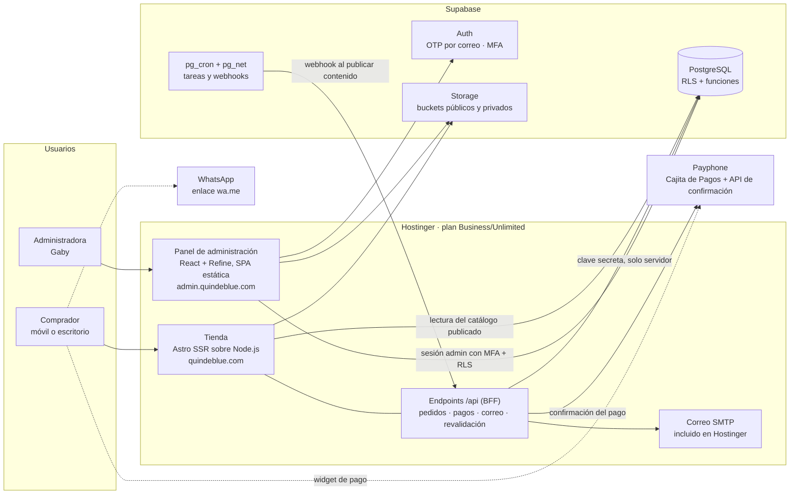

> Los dominios son de ejemplo hasta definir el definitivo.

#### Patrón arquitectónico

La solución combina cuatro patrones conocidos:

| Patrón | Dónde se aplica | Qué aporta |
|---|---|---|
| **Arquitectura de islas** (*Islands Architecture*) | Tienda en Astro | Cada página llega como HTML ya renderizado y solo los componentes interactivos (personalizador, "Crea tu caja", carrito, checkout) cargan JavaScript. |
| **Backend as a Service (BaaS)** | Supabase | Base de datos, autenticación, archivos y tareas programadas gestionados, sin servidor propio que mantener. |
| **Backend for Frontend (BFF)** | Endpoints `/api` de Astro | Una capa delgada de servidor solo para lo que no puede ocurrir en el navegador: crear pedidos con precios recalculados, confirmar pagos con Payphone y enviar correos. |
| **Monorepo** | Repositorio único | La tienda, el panel, los tipos, las validaciones y el motor de precios se versionan juntos y comparten código. |

#### Por qué esta arquitectura

Las restricciones del proyecto son: JavaScript/TypeScript de punta a punta, Supabase como base de datos y autenticación, alojamiento en Hostinger (plan Business/Unlimited), pagos con Payphone, una tienda muy visual que cargue rápido y un panel fácil de usar para una sola administradora. Esta combinación es la que mejor encaja:

- **Hostinger Business/Unlimited ejecuta aplicaciones Node.js, pero con recursos compartidos.** Admite hasta 5 aplicaciones Node.js, que comparten memoria y procesos. Corta cada petición a los 120 segundos y no admite procesos permanentes en segundo plano, WebSockets entrantes ni Redis. Astro tiene un servidor ligero y el panel se sirve como archivos estáticos, así que solo la tienda ocupa un proceso Node.js.
- **Payphone exige un servidor.** La Cajita de Pagos se incrusta en la página, pero el pago debe confirmarse desde el servidor, con el token de la tienda, en los 5 minutos siguientes. Si no, Payphone revierte la transacción. Los endpoints `/api` cumplen esa función.
- **Supabase cubre lo que Hostinger no permite.** Las tareas programadas (`pg_cron`), los webhooks (`pg_net`) y las reglas de acceso por fila (RLS) viven en la base de datos.
- **El rendimiento es prioridad en un catálogo visual.** La tienda tiene unos 20 productos con mucha fotografía y pocas piezas muy interactivas. Las islas de Astro reducen el JavaScript que descarga el celular sin limitar la interactividad donde se necesita.

#### Beneficios principales

| Beneficio | Detalle |
|---|---|
| **Carga rápida en móvil** | HTML renderizado en el servidor y JavaScript solo en las islas interactivas. Las imágenes se sirven optimizadas. |
| **Un solo lenguaje** | TypeScript en la tienda, el panel, los endpoints y los scripts. Los tipos de la base de datos se generan automáticamente desde Supabase. |
| **Seguridad por diseño** | Las reglas de acceso viven en la base de datos (RLS), así que se aplican igual desde la tienda, el panel o cualquier cliente. |
| **Infraestructura mínima** | Un proceso Node.js, un sitio estático y un proyecto de Supabase. No hay servidores propios ni contenedores. |
| **Contenido editable sin código** | Las páginas se arman con bloques predefinidos desde el panel y se publican al instante, sin redesplegar. |
| **Crecimiento sin reescritura** | Si el tráfico crece, la tienda pasa a un plan Cloud o a un VPS de Hostinger sin cambiar la arquitectura. |

#### Sacrificios y riesgos

| Sacrificio o riesgo | Mitigación |
|---|---|
| Dependencia de Supabase (proveedor gestionado). | Todo el esquema está en migraciones SQL versionadas. Supabase usa PostgreSQL estándar, así que la base de datos es portable. |
| Recursos compartidos en Hostinger y sin procesos en segundo plano. | Las tareas largas o programadas van a `pg_cron`. Las páginas se cachean para reducir la carga. |
| Dos aplicaciones que mantener (tienda y panel). | Comparten un paquete común (tipos, validaciones, bloques y precios) y un pipeline de CI único. |
| Ventana de 5 minutos de Payphone: si el comprador cierra el navegador antes de volver a la tienda, el pago se revierte. | Se muestra un estado claro de "pago no completado" con la opción de reintentar. Hay que consultar a Payphone si ofrece notificación de servidor a servidor. |
| La Cajita de Pagos necesita el token de Payphone en el navegador, por diseño del proveedor. | Payphone solo permite usarla en el dominio registrado. La confirmación se hace en el servidor y valida el monto contra el pedido. Hay que consultar a Payphone si puede emitir un token aparte para la confirmación. |
| El plan gratuito de Supabase pausa el proyecto por inactividad y no incluye respaldos automáticos. | Usar el plan Pro en producción. El plan gratuito queda para desarrollo y staging. |

### **2.2. Descripción de componentes principales:**

| Componente | Tecnología | Responsabilidad |
|---|---|---|
| **Tienda** | Astro (SSR con `@astrojs/node`), React para las islas, Tailwind CSS, nanostores, Zod | Páginas públicas, configuradores, carrito y checkout. |
| **Endpoints BFF** | Rutas `/api` de Astro sobre Node.js 22 | Crear pedidos, confirmar pagos, enviar correos, revalidar la caché. |
| **Panel de administración** | Vite + React + Refine (`@refinedev/supabase`), editor de bloques con dnd-kit | Gestión de catálogo, contenido, pedidos, clientes y promociones. |
| **Paquete compartido** | TypeScript + Zod | Tipos de la base de datos, esquemas de validación, motor de precios y catálogo de bloques. |
| **Base de datos** | Supabase PostgreSQL, RLS, funciones SQL | Datos del negocio, reglas de acceso y lógica crítica (precios, pedidos, pagos). |
| **Autenticación** | Supabase Auth | OTP por correo para clientes recurrentes (opcional) y acceso con MFA para la administradora. |
| **Archivos** | Supabase Storage | Fotos y videos de producto (públicos), comprobantes de transferencia (privados). |
| **Tareas programadas** | `pg_cron` y `pg_net` en Supabase | Liberar pedidos sin pago, recordatorios, segmentación del CRM, webhooks de revalidación. |
| **Pasarela de pago** | Payphone, Cajita de Pagos + API de confirmación | Cobro con tarjeta o saldo Payphone sin salir de la tienda. |
| **Correo transaccional** | SMTP de Hostinger con Nodemailer | Confirmación de pedido, cambios de estado y enlace de seguimiento. |

#### Tienda (Astro)

- **Renderizado:** las páginas se generan en el servidor (SSR) con una caché en memoria de vida corta. Cuando Gaby publica un cambio, un webhook de la base de datos llama a `/api/revalidar` y la página se regenera sin redesplegar el sitio.
- **Islas interactivas (React):**
  - `Personalizador` (F3): modelo base y opciones del producto.
  - `CreaTuCaja` (F12): productos, capacidad, caja, dedicatoria y vista previa.
  - `VisorProducto` (F4): exploración interactiva del producto.
  - `Carrito` y `Checkout` (F5, F6).
- **Estado del carrito:** se guarda con nanostores en el almacenamiento local del navegador. Solo contiene identificadores de producto y opciones, nunca precios autoritativos ni datos personales.
- **Precio en pantalla:** el motor de precios del paquete compartido calcula el subtotal al instante en el navegador. El precio que se cobra lo recalcula siempre la base de datos al crear el pedido.
- **Bloques de contenido:** las páginas de producto, las colecciones y "Detrás de la marca" se renderizan a partir de una lista de bloques tipados en JSON (portada, galería, texto, visor interactivo, preguntas frecuentes, botón de personalizar, testimonios). Cada tipo de bloque tiene un componente visual en la tienda.
- **Imágenes:** se sirven en WebP o AVIF y al tamaño exacto, con carga diferida. Se usan las transformaciones de imagen de Supabase (plan Pro) o, como alternativa, la optimización de Astro.

#### Endpoints BFF (`/api`)

| Endpoint | Función |
|---|---|
| `POST /api/pedidos` | Valida el carrito y los datos de entrega con Zod y llama a la función `crear_pedido()` de la base de datos. Esa función recalcula los precios, valida la capacidad de las cajas, el stock y los cupones, y devuelve el código del pedido y el monto en centavos para Payphone. |
| `POST /api/pagos/payphone/confirmar` | Lo llama la página de retorno de Payphone (`/pago/respuesta`). Confirma la transacción con la API de Payphone y registra el pago con `registrar_pago()`. Es idempotente. |
| `POST /api/pedidos/{token}/comprobante` | Recibe el comprobante de transferencia, lo guarda en un bucket privado y pasa el pedido a revisión. |
| `POST /api/revalidar` | Invalida la caché de las páginas afectadas cuando se publica contenido. Está protegido con un secreto compartido. |

El flujo de pago con Payphone:

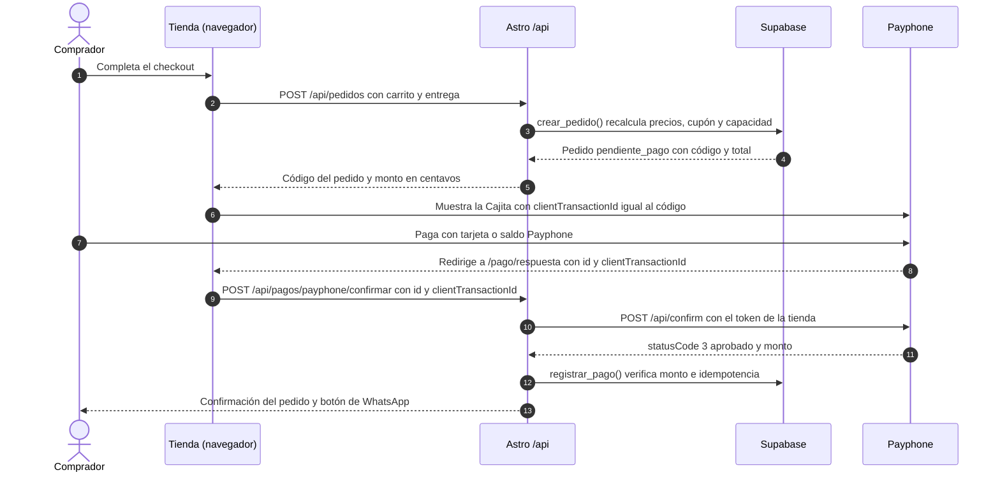

#### Panel de administración (React + Refine)

- **Recursos CRUD:** productos, modelos base, opciones de personalización, categorías, colecciones, tamaños y diseños de caja, tarjetas, pedidos, clientes, cupones y lanzamientos.
- **Editor de páginas por bloques:** Gaby agrega, ordena (arrastrar y soltar) y edita bloques predefinidos. Cada bloque se valida con su esquema Zod del paquete compartido.
- **Borrador y publicación:** el contenido tiene estado borrador o publicado. La vista previa abre la página real de la tienda en un marco con un token temporal. Al publicar, se dispara la revalidación.
- **Mini CRM:** clientes creados automáticamente con cada pedido, historial, segmentos (nuevo, recurrente, inactivo) e importación de la lista actual en CSV.
- **Promociones y lanzamientos:** cupones con reglas y vigencia, y lanzamientos programados con acceso anticipado para un segmento de clientes.
- **Pedidos:** cambio de estados, validación de comprobantes de transferencia y vista de las cajas armadas con la dedicatoria que hay que escribir a mano.
- **Despliegue:** se compila a archivos estáticos y se sirve en un subdominio propio. No consume un proceso Node.js y queda aislado de la tienda.

#### Base de datos (Supabase)

- **Lógica crítica en funciones SQL:** `crear_pedido()`, `cotizar_carrito()`, `registrar_pago()`, `aplicar_cupon()` y `publicar_contenido()`. Las ejecuta la base de datos, así que nadie puede saltarse las reglas desde el navegador.
- **RLS en todas las tablas:** el catálogo publicado es de lectura pública, y la escritura queda reservada a la administradora con MFA. Los clientes autenticados solo ven sus propios pedidos y direcciones.
- **Triggers:** alta automática del cliente en el CRM al crear un pedido, registro de auditoría de las acciones administrativas y webhook de revalidación al publicar.
- **Tareas programadas con `pg_cron`:** liberar pedidos con transferencia sin comprobante después de 48 horas, recalcular segmentos del CRM cada noche y activar los lanzamientos en su fecha.

### **2.3. Descripción de alto nivel del proyecto y estructura de ficheros**

El proyecto es un **monorepo con npm workspaces**: dos aplicaciones, un paquete compartido y la carpeta de Supabase con el esquema como código.

```
QBtienda/
├── apps/
│   ├── tienda/                    # Tienda pública (Astro + islas React)
│   │   ├── src/
│   │   │   ├── pages/             # Rutas: inicio, categorías, producto/[slug],
│   │   │   │   │                  # crea-tu-caja, carrito, checkout,
│   │   │   │   │                  # pago/respuesta, pedido/[token], detras-de-la-marca
│   │   │   │   └── api/           # Endpoints BFF: pedidos, pagos, comprobantes, revalidar
│   │   │   ├── islands/           # Componentes React interactivos: Personalizador,
│   │   │   │                      # CreaTuCaja, VisorProducto, Carrito, Checkout
│   │   │   ├── blocks/            # Un componente visual por tipo de bloque de contenido
│   │   │   ├── components/        # Componentes Astro estáticos (cabecera, tarjetas, pie)
│   │   │   ├── layouts/           # Plantillas de página
│   │   │   ├── lib/               # Clientes de Supabase (servidor y navegador),
│   │   │   │                      # Payphone, correo, caché
│   │   │   ├── stores/            # Estado del carrito y de la caja (nanostores)
│   │   │   ├── middleware.ts      # Cabeceras de seguridad y límite de solicitudes
│   │   │   └── styles/            # Tailwind y tokens de marca
│   │   ├── public/                # Favicon, fuentes y archivos estáticos
│   │   └── astro.config.mjs
│   └── admin/                     # Panel de administración (Vite + React + Refine)
│       └── src/
│           ├── resources/         # Una carpeta por recurso: productos, categorias,
│           │                      # colecciones, cajas, pedidos, clientes,
│           │                      # promociones, paginas
│           ├── components/
│           │   └── editor-bloques/ # Editor de páginas por bloques y vista previa
│           ├── providers/         # Proveedores de datos y autenticación de Supabase
│           └── App.tsx
├── packages/
│   └── shared/                    # Código compartido entre tienda y panel
│       └── src/
│           ├── database.types.ts  # Tipos generados desde Supabase
│           ├── schemas/           # Esquemas Zod (carrito, checkout, bloques, cupones)
│           ├── pricing/           # Motor de precios (productos, cajas, cupones, envío)
│           └── blocks/            # Catálogo de tipos de bloque y sus campos
├── supabase/
│   ├── migrations/                # Esquema, RLS, funciones y triggers en SQL versionado
│   ├── tests/                     # Pruebas de base de datos y RLS (pgTAP)
│   ├── seed.sql                   # Datos de ejemplo para desarrollo
│   └── config.toml                # Configuración del entorno local de Supabase
├── tests/
│   └── e2e/                       # Pruebas de extremo a extremo (Playwright)
├── .github/
│   └── workflows/                 # CI, migraciones y despliegue del panel
├── .env.example                   # Variables de entorno necesarias, sin valores reales
├── package.json                   # Definición de workspaces y scripts comunes
└── README.md
```

| Carpeta | Propósito | Patrón |
|---|---|---|
| `apps/tienda` | Sitio público y endpoints de servidor. | Arquitectura de islas con BFF. |
| `apps/admin` | Panel de administración. | Organización por recursos, al estilo de Refine. |
| `packages/shared` | Fuente única de verdad para tipos, validaciones, precios y bloques. | Núcleo de dominio compartido. |
| `supabase` | Esquema, reglas de acceso y lógica de base de datos como código. | Migraciones versionadas (*database as code*). |
| `tests/e2e` | Recorridos completos del comprador y de la administradora. | Pruebas de extremo a extremo. |

### **2.4. Infraestructura y despliegue**

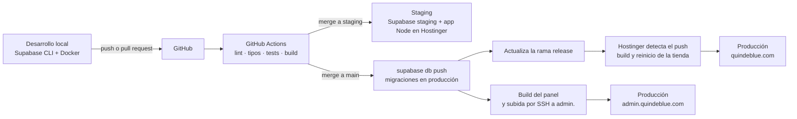

#### Infraestructura

| Elemento | Proveedor | Detalle |
|---|---|---|
| Tienda | Hostinger, aplicación Node.js (Node 22) | Conectada a GitHub. Hostinger compila y reinicia la aplicación en cada push a la rama `release`. |
| Panel | Hostinger, sitio estático en subdominio | Archivos compilados en GitHub Actions y subidos por SSH. |
| Staging | Hostinger, segunda aplicación Node.js + proyecto de Supabase aparte | Usa 2 de las 5 aplicaciones Node.js del plan. Se prueba con Payphone en modo de pruebas. |
| Base de datos, auth, archivos y tareas | Supabase: plan Pro en producción, gratuito en staging | Respaldos diarios en el plan Pro. |
| Dominio, SSL y correo | Hostinger | Certificado SSL gratuito, requisito de Payphone en producción. El correo del dominio se usa como SMTP. |
| Pagos | Payphone | Entorno de pruebas para staging y de producción en el dominio registrado. |

#### Proceso de despliegue

1. **Desarrollo:** cada cambio se trabaja en una rama propia con Supabase local. Los cambios de base de datos se crean como migraciones SQL.
2. **Pull request:** GitHub Actions ejecuta lint, verificación de tipos, pruebas unitarias, pruebas de base de datos (pgTAP) y el build de ambas aplicaciones. Si algo falla, el pull request no se puede fusionar.
3. **Staging:** al fusionar en `staging`, se aplican las migraciones al Supabase de staging, la tienda de staging se recompila y se ejecutan las pruebas de extremo a extremo con Payphone en modo de pruebas.
4. **Producción:** al fusionar en `main`, GitHub Actions:
   1. aplica las migraciones al Supabase de producción (`supabase db push`);
   2. actualiza la rama `release`, y Hostinger recompila y reinicia la tienda;
   3. compila el panel y lo sube al subdominio por SSH.

   Así, la tienda nunca se despliega con una base de datos desactualizada.
5. **Reversión:** Hostinger conserva los dos últimos builds exitosos. Las migraciones siguen el criterio de "expandir y luego contraer" (primero se agregan columnas, después se eliminan las viejas), para que el código anterior siga funcionando con el esquema nuevo.

#### Variables de entorno

| Variable | Dónde | ¿Pública? |
|---|---|---|
| `PUBLIC_SUPABASE_URL` y `PUBLIC_SUPABASE_ANON_KEY` | Tienda y panel | Sí. Es la clave pública; RLS protege los datos. |
| `SUPABASE_SERVICE_ROLE_KEY` | Solo en el servidor de la tienda | **No.** Nunca se incluye en el código del navegador. |
| `PAYPHONE_TOKEN` y `PAYPHONE_STORE_ID` | Servidor de la tienda | El token también lo usa la Cajita por diseño de Payphone, y está restringido al dominio registrado. |
| `SMTP_HOST`, `SMTP_USER`, `SMTP_PASS` | Servidor de la tienda | **No.** |
| `REVALIDATE_SECRET` y `PREVIEW_SECRET` | Servidor de la tienda y Supabase | **No.** |

#### Respaldos

- **Base de datos:** respaldos diarios automáticos del plan Pro de Supabase.
- **Archivos:** los respaldos de Supabase no incluyen los archivos de Storage. Un flujo programado de GitHub Actions copia cada semana los buckets a un almacenamiento externo.

### **2.5. Seguridad**

#### Protección de datos y acceso

- **Row Level Security en todas las tablas.** Las reglas de acceso viven en la base de datos, así que se aplican igual desde la tienda, el panel o cualquier cliente. Por ejemplo:

  ```sql
  -- La administradora debe estar registrada y haber iniciado sesión con MFA
  create function public.es_admin() returns boolean
  language sql stable security definer set search_path = '' as $$
    select exists (select 1 from public.administradores a where a.user_id = auth.uid())
       and (auth.jwt() ->> 'aal') = 'aal2';
  $$;

  alter table public.productos enable row level security;

  create policy "Catálogo publicado visible para todos"
    on public.productos for select
    using (estado = 'publicado' or public.es_admin());

  create policy "Solo la administración modifica productos"
    on public.productos for all
    using (public.es_admin()) with check (public.es_admin());
  ```

- **Panel con MFA obligatorio.** Para escribir en el panel se exige autenticación de dos factores (TOTP de Supabase) y un registro en la tabla `administradores`. Un usuario que solo inició sesión con contraseña no puede modificar nada.
- **Compra sin cuenta, con acceso seguro al pedido.** El comprador invitado consulta su pedido con un enlace que lleva un token aleatorio (`/pedido/[token]`), enviado a su correo. Los números de pedido no se pueden adivinar ni recorrer.
- **Datos de clientes recurrentes protegidos.** Las direcciones guardadas solo se muestran después de verificar el correo con un código OTP. Escribir un correo en el checkout no revela ningún dato.
- **Secretos solo en el servidor.** La clave secreta de Supabase, las credenciales SMTP y los secretos de revalidación nunca llegan al navegador.
- **Archivos privados.** Los comprobantes de transferencia se guardan en un bucket privado y solo se ven con enlaces firmados de corta duración desde el panel.

#### Integridad de pedidos y pagos

- **El precio nunca viene del navegador.** `crear_pedido()` recalcula en la base de datos el precio de cada producto, personalización, caja, tarjeta, cupón y envío. El precio que muestra la tienda es solo informativo.
- **Confirmación del pago en el servidor.** Al volver de Payphone, el servidor confirma la transacción con la API de Payphone y `registrar_pago()` verifica que:
  - el estado sea aprobado (`statusCode` 3);
  - el monto confirmado coincida con el total del pedido;
  - el pedido no haya sido pagado antes. El código del pedido es único y se usa como `clientTransactionId`, así que el mismo pago no se registra dos veces.

  ```ts
  // apps/tienda/src/pages/api/pagos/payphone/confirmar.ts (esquema)
  const respuesta = await fetch("https://paymentbox.payphonetodoesposible.com/api/confirm", {
    method: "POST",
    headers: {
      Authorization: `Bearer ${import.meta.env.PAYPHONE_TOKEN}`,
      "Content-Type": "application/json",
    },
    body: JSON.stringify({ id, clientTxId }),
  });
  const pago = await respuesta.json();
  // registrar_pago() valida estado, monto e idempotencia antes de marcar el pedido como pagado
  await supabaseAdmin.rpc("registrar_pago", { p_codigo: clientTxId, p_respuesta: pago });
  ```

- **Sin datos de tarjeta en la plataforma.** Los datos de tarjeta los procesa Payphone. Quinde Blue solo guarda el código de autorización, la marca y los últimos cuatro dígitos que devuelve la confirmación.

#### Protección de la aplicación

- **Validación en cliente y servidor** con los mismos esquemas Zod del paquete compartido (checkout, dirección, dedicatoria, cupones, bloques de contenido).
- **Protección contra bots:** Cloudflare Turnstile en el checkout y en el envío de códigos OTP, que Supabase Auth soporta. Se suman límites de solicitudes por IP en los endpoints `/api` y los límites propios de Supabase Auth.
- **Cabeceras de seguridad** desde el middleware de Astro: Content Security Policy (que solo permite los dominios de Supabase y Payphone), HSTS, `X-Content-Type-Options` y `frame-ancestors` (para que la tienda no se pueda incrustar en sitios ajenos).
- **HTTPS obligatorio** con el certificado SSL de Hostinger, que además es requisito de Payphone.
- **Auditoría:** un trigger registra quién cambió qué y cuándo en productos, precios, pedidos y cupones.
- **Dependencias:** Dependabot y `npm audit` en la CI.

#### Privacidad

- **Cumplimiento de la Ley Orgánica de Protección de Datos Personales de Ecuador:**
  - consentimiento explícito y separado para recibir promociones;
  - política de privacidad visible;
  - función en el panel para anonimizar a un cliente que lo solicite.
- **Datos mínimos:** el checkout pide solo lo necesario para entregar el pedido.

### **2.6. Tests**

> Esta entrega es solo documentación. Estos son los tests planificados para la implementación.

| Tipo | Herramienta | Qué se prueba | Ejemplos de casos |
|---|---|---|---|
| **Unitarios** | Vitest | Motor de precios y esquemas del paquete compartido. | Una caja con 3 piezas, personalización y tarjeta suma el total correcto. Una pieza que excede la capacidad de la caja se rechaza. Un cupón vencido no aplica descuento. Una dedicatoria de más de 300 caracteres no pasa la validación. |
| **Base de datos y RLS** | pgTAP (`supabase test db`) | Reglas de acceso y funciones SQL. | Un visitante no ve productos en borrador. Una sesión sin MFA no puede modificar productos. `crear_pedido()` ignora un precio manipulado desde el cliente. `registrar_pago()` rechaza un monto distinto al del pedido y un segundo pago del mismo pedido. |
| **Integración de endpoints** | Vitest con la API de Payphone simulada | Flujo de pedido y pago en el servidor. | Pago aprobado: el pedido pasa a "pagado" y se envía el correo. Pago cancelado (`statusCode` 2): el pedido sigue pendiente. Error de red al confirmar: se muestra "pago no completado". |
| **Extremo a extremo** | Playwright, en escritorio y móvil | Recorridos completos. | Compra como invitado con transferencia y carga de comprobante. Compra con Payphone en modo de pruebas. "Crea tu caja" de principio a fin, con el panel inferior en móvil. Gaby publica un bloque en el panel y aparece en la tienda. |
| **Rendimiento y accesibilidad** | Lighthouse CI | Presupuestos en cada pull request. | LCP menor a 2,5 s en móvil en la ficha de producto, puntaje de accesibilidad de 90 o más y un presupuesto de JavaScript por página. |

---

## 3. Modelo de Datos

El modelo vive en **Supabase (PostgreSQL)** y se define con migraciones SQL versionadas en `supabase/migrations`. Cubre todas las funcionalidades descritas en la sección 1.2 (F1 a F12) y las reglas de seguridad de la sección 2.5.

**Criterios de diseño:**

| Criterio | Decisión | Motivo |
|---|---|---|
| Identificadores | `uuid` con `gen_random_uuid()` en todas las tablas de negocio | No se pueden adivinar ni recorrer desde la tienda, y no revelan el volumen de ventas. |
| Dinero | Enteros en **centavos** (`int` o `bigint`) | Evita errores de redondeo y coincide con el formato que exige Payphone. |
| Fechas | `timestamptz` | Hora exacta independiente de la zona horaria del servidor. |
| Textos únicos sin distinguir mayúsculas | `citext` para correos, slugs y códigos de cupón | `Ana@Mail.com` y `ana@mail.com` se tratan como el mismo correo. |
| Historial de pedidos | **Copia (snapshot)** del nombre, precio y opciones en cada línea de pedido | Si Gaby cambia un precio o borra una opción, los pedidos anteriores no cambian. |
| Contenido editable | `jsonb` para los bloques de página, con versión borrador y versión publicada | Gaby edita sin afectar lo publicado. Los tipos de bloque se validan con Zod en el paquete compartido. |
| Borrado | Estados (`borrador`, `publicado`, `archivado`, `activo`) en lugar de borrar filas | Se conserva la integridad de los pedidos y del historial. |
| Usuarios | Las cuentas viven en `auth.users`, que gestiona Supabase Auth; las tablas propias se vinculan a ella | La autenticación queda en Supabase y los datos de negocio, en tablas propias. |

### **3.1. Diagrama del modelo de datos:**

#### Vista general de relaciones

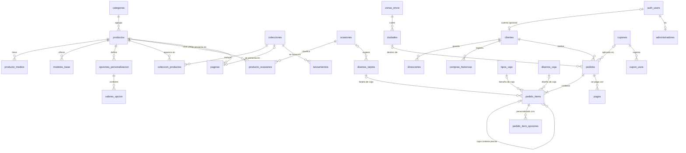

#### Catálogo y contenido (F1, F2, F3, F4, F11)

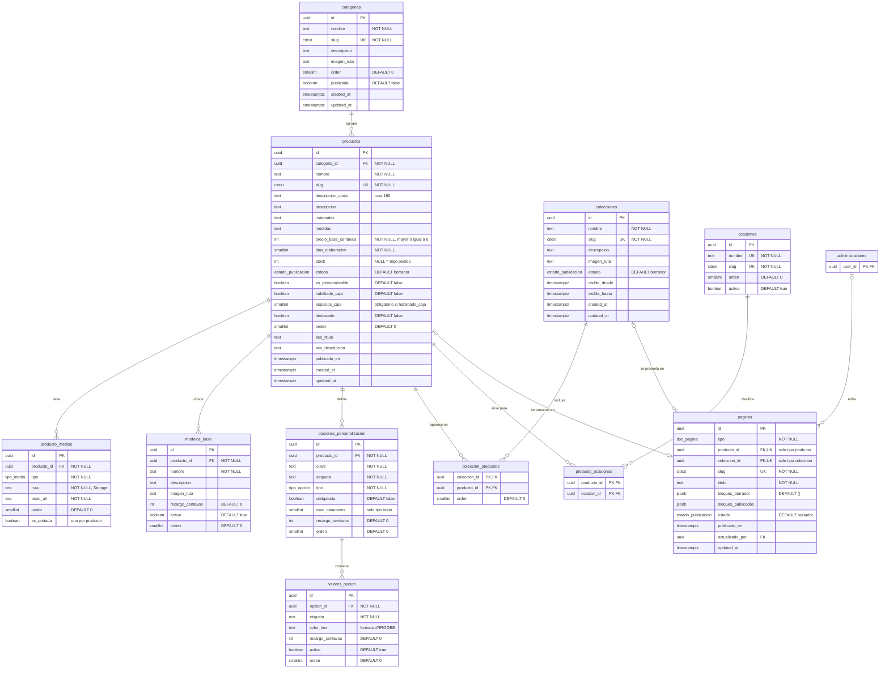

#### Caja de regalo, envíos y configuración (F6, F12)

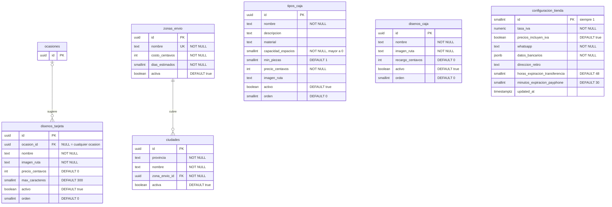

#### Clientes, pedidos y pagos (F5, F6, F7, F8, F12)

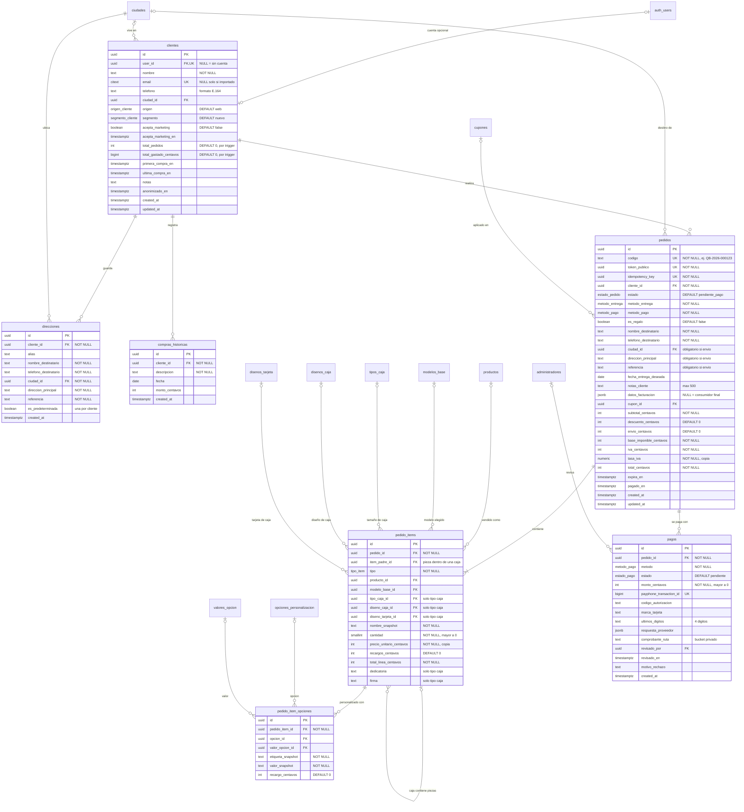

#### Promociones, administración y auditoría (F9, F10)

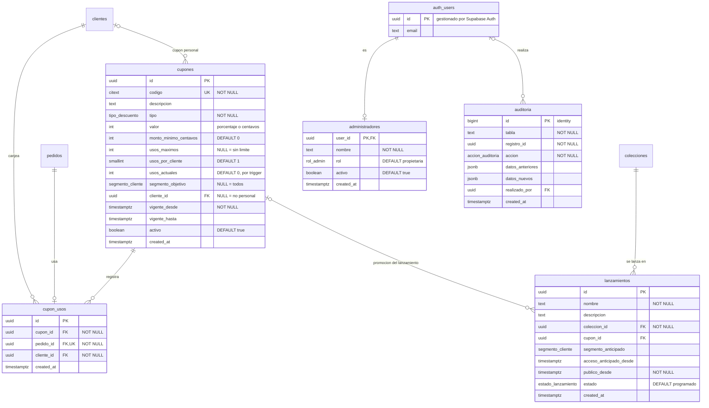

#### Ciclo de vida de un pedido

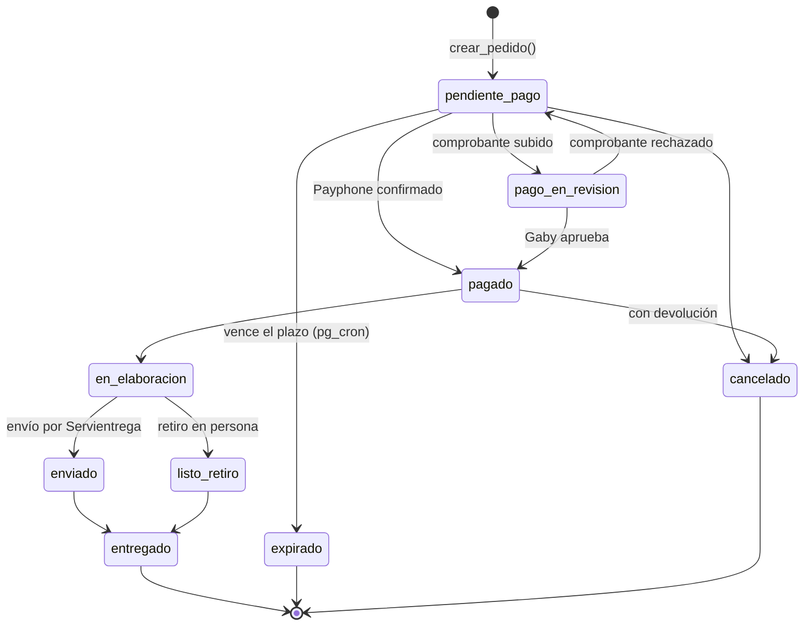

### **3.2. Descripción de entidades principales:**

> Convenciones de todas las tablas: `id uuid PRIMARY KEY DEFAULT gen_random_uuid()` (salvo que se indique otra cosa); `created_at` y `updated_at` son `timestamptz NOT NULL DEFAULT now()`, y un trigger actualiza `updated_at` en cada modificación. Todas las tablas tienen **RLS activado**.

#### Tipos enumerados

| Tipo | Valores | Uso |
|---|---|---|
| `estado_publicacion` | `borrador`, `publicado`, `archivado` | Productos, colecciones y páginas. |
| `tipo_medio` | `imagen`, `video` | Medios de producto. |
| `tipo_opcion` | `seleccion`, `color`, `texto` | Opciones de personalización. |
| `tipo_pagina` | `inicio`, `producto`, `coleccion`, `marca`, `libre` | Páginas editables por bloques. |
| `origen_cliente` | `web`, `importado` | Si el cliente compró en la web o viene de la lista actual. |
| `segmento_cliente` | `nuevo`, `recurrente`, `inactivo` | Segmentación del mini CRM. |
| `estado_pedido` | `pendiente_pago`, `pago_en_revision`, `pagado`, `en_elaboracion`, `enviado`, `listo_retiro`, `entregado`, `cancelado`, `expirado` | Ciclo de vida del pedido. |
| `metodo_entrega` | `envio`, `retiro` | Envío por Servientrega o retiro en persona. |
| `metodo_pago` | `payphone`, `transferencia` | Métodos de pago aceptados. |
| `tipo_item` | `producto`, `caja`, `pieza_caja` | Tipo de línea de pedido. |
| `estado_pago` | `pendiente`, `en_revision`, `aprobado`, `rechazado`, `cancelado`, `revertido` | Estado de cada intento de pago. |
| `tipo_descuento` | `porcentaje`, `monto_fijo`, `envio_gratis` | Tipo de cupón. |
| `estado_lanzamiento` | `programado`, `activo`, `finalizado` | Lanzamientos de colecciones. |
| `rol_admin` | `propietaria`, `colaborador` | Rol en el panel. |
| `accion_auditoria` | `insert`, `update`, `delete` | Tipo de cambio registrado. |

---

#### Catálogo

**`categorias`**: agrupan los productos de la tienda (unas 4, F1).

| Atributo | Tipo | Restricciones | Descripción |
|---|---|---|---|
| `id` | `uuid` | PK | Identificador. |
| `nombre` | `text` | NOT NULL | Nombre visible, por ejemplo "Cuadernos". |
| `slug` | `citext` | UNIQUE, NOT NULL | Fragmento de la URL, por ejemplo `/cuadernos`. |
| `descripcion` | `text` | | Texto introductorio de la categoría. |
| `imagen_ruta` | `text` | | Ruta de la imagen en Storage. |
| `orden` | `smallint` | NOT NULL, DEFAULT 0 | Posición en el menú. |
| `publicada` | `boolean` | NOT NULL, DEFAULT false | Solo las publicadas se ven en la tienda. |

**`productos`**: cada producto del catálogo curado (unos 20, F1 y F2).

| Atributo | Tipo | Restricciones | Descripción |
|---|---|---|---|
| `id` | `uuid` | PK | Identificador. |
| `categoria_id` | `uuid` | FK → `categorias.id`, NOT NULL, ON DELETE RESTRICT | Categoría a la que pertenece. |
| `nombre` | `text` | NOT NULL | Nombre comercial. |
| `slug` | `citext` | UNIQUE, NOT NULL | URL de la ficha (`/producto/cuaderno-kraft`). |
| `descripcion_corta` | `text` | CHECK longitud ≤ 160 | Resumen para tarjetas y SEO. |
| `descripcion` | `text` | | Descripción completa. |
| `materiales`, `medidas` | `text` | | Información técnica que hoy se pregunta por chat. |
| `precio_base_centavos` | `int` | NOT NULL, CHECK ≥ 0 | Precio sin personalización. |
| `dias_elaboracion` | `smallint` | NOT NULL, CHECK > 0 | Tiempo de fabricación que se muestra al cliente. |
| `stock` | `int` | CHECK ≥ 0 | `NULL` significa "hecho bajo pedido". Con 0, el producto deja de mostrarse en el configurador de cajas. |
| `estado` | `estado_publicacion` | NOT NULL, DEFAULT `borrador` | Solo los publicados son visibles. |
| `es_personalizable` | `boolean` | NOT NULL, DEFAULT false | Activa el personalizador (F3). |
| `habilitado_caja` | `boolean` | NOT NULL, DEFAULT false | Permite incluirlo en "Crea tu caja" (F12). |
| `espacios_caja` | `smallint` | CHECK > 0; CHECK (`NOT habilitado_caja OR espacios_caja IS NOT NULL`) | Cuántos espacios ocupa dentro de una caja. |
| `destacado` | `boolean` | NOT NULL, DEFAULT false | Aparece en el inicio. |
| `orden` | `smallint` | NOT NULL, DEFAULT 0 | Orden dentro de la categoría. |
| `seo_titulo`, `seo_descripcion` | `text` | | Metadatos para buscadores y redes sociales. |
| `publicado_en` | `timestamptz` | | Fecha de la primera publicación. |

**`producto_medios`**: fotos y videos propios del producto (F2).

| Atributo | Tipo | Restricciones | Descripción |
|---|---|---|---|
| `id` | `uuid` | PK | Identificador. |
| `producto_id` | `uuid` | FK → `productos.id`, NOT NULL, ON DELETE CASCADE | Producto al que pertenece. |
| `tipo` | `tipo_medio` | NOT NULL | Imagen o video. |
| `ruta` | `text` | NOT NULL | Ruta en el bucket público de Storage. |
| `texto_alt` | `text` | NOT NULL | Descripción para accesibilidad y SEO. |
| `orden` | `smallint` | NOT NULL, DEFAULT 0 | Orden en la galería. |
| `es_portada` | `boolean` | NOT NULL, DEFAULT false; índice único parcial `(producto_id) WHERE es_portada` | Imagen principal; solo una por producto. |

**`modelos_base`**: los 5 a 10 diseños base de un producto personalizable (F3).

| Atributo | Tipo | Restricciones | Descripción |
|---|---|---|---|
| `id` | `uuid` | PK | Identificador. |
| `producto_id` | `uuid` | FK → `productos.id`, NOT NULL, ON DELETE CASCADE | Producto al que pertenece. |
| `nombre` | `text` | NOT NULL; UNIQUE (`producto_id`, `nombre`) | Nombre del modelo, por ejemplo "Floral". |
| `descripcion` | `text` | | Detalle del diseño. |
| `imagen_ruta` | `text` | | Imagen del modelo. |
| `recargo_centavos` | `int` | NOT NULL, DEFAULT 0, CHECK ≥ 0 | Costo adicional del modelo, si lo tiene. |
| `activo` | `boolean` | NOT NULL, DEFAULT true | Un trigger limita a 10 los modelos activos por producto. |
| `orden` | `smallint` | NOT NULL, DEFAULT 0 | Orden de presentación. |

**`opciones_personalizacion`**: los campos que el cliente puede personalizar en un producto, como color, nombre o tipo de hojas (F3).

| Atributo | Tipo | Restricciones | Descripción |
|---|---|---|---|
| `id` | `uuid` | PK | Identificador. |
| `producto_id` | `uuid` | FK → `productos.id`, NOT NULL, ON DELETE CASCADE | Producto al que aplica. |
| `clave` | `text` | NOT NULL; UNIQUE (`producto_id`, `clave`) | Identificador técnico (`color`, `nombre`, `hojas`). |
| `etiqueta` | `text` | NOT NULL | Texto visible, por ejemplo "Tipo de hojas". |
| `tipo` | `tipo_opcion` | NOT NULL | Lista de valores, selector de color o texto libre. |
| `obligatoria` | `boolean` | NOT NULL, DEFAULT false | Si el cliente debe completarla. |
| `max_caracteres` | `smallint` | CHECK (`tipo <> 'texto' OR max_caracteres IS NOT NULL`) | Límite de caracteres para las opciones de texto. |
| `recargo_centavos` | `int` | NOT NULL, DEFAULT 0, CHECK ≥ 0 | Costo de una opción de texto, como un grabado. |
| `orden` | `smallint` | NOT NULL, DEFAULT 0 | Orden en el personalizador. |

**`valores_opcion`**: valores disponibles para las opciones de tipo `seleccion` o `color`.

| Atributo | Tipo | Restricciones | Descripción |
|---|---|---|---|
| `id` | `uuid` | PK | Identificador. |
| `opcion_id` | `uuid` | FK → `opciones_personalizacion.id`, NOT NULL, ON DELETE CASCADE | Opción a la que pertenece. |
| `etiqueta` | `text` | NOT NULL; UNIQUE (`opcion_id`, `etiqueta`) | Por ejemplo "Rayadas" o "Azul". |
| `color_hex` | `char(7)` | CHECK formato `#RRGGBB` | Color de muestra para las opciones de tipo color. |
| `recargo_centavos` | `int` | NOT NULL, DEFAULT 0, CHECK ≥ 0 | Costo adicional del valor. |
| `activo` | `boolean` | NOT NULL, DEFAULT true | Permite ocultar un valor sin borrarlo. |
| `orden` | `smallint` | NOT NULL, DEFAULT 0 | Orden de presentación. |

**`colecciones`** y **`coleccion_productos`**: agrupaciones temáticas o de temporada (por ejemplo, Navidad o Día del Maestro), con productos ordenados. Una colección puede tener una ventana de visibilidad.

| Atributo | Tipo | Restricciones | Descripción |
|---|---|---|---|
| `colecciones.id` | `uuid` | PK | Identificador. |
| `colecciones.nombre` | `text` | NOT NULL | Nombre visible. |
| `colecciones.slug` | `citext` | UNIQUE, NOT NULL | URL de la colección. |
| `colecciones.descripcion`, `imagen_ruta` | `text` | | Contenido de la portada. |
| `colecciones.estado` | `estado_publicacion` | NOT NULL, DEFAULT `borrador` | Publicación. |
| `colecciones.visible_desde`, `visible_hasta` | `timestamptz` | CHECK (`visible_hasta > visible_desde`) | Ventana de visibilidad; `NULL` significa sin límite. |
| `coleccion_productos.coleccion_id` | `uuid` | PK compuesta, FK → `colecciones.id`, ON DELETE CASCADE | Relación muchos a muchos. |
| `coleccion_productos.producto_id` | `uuid` | PK compuesta, FK → `productos.id`, ON DELETE CASCADE | Relación muchos a muchos. |
| `coleccion_productos.orden` | `smallint` | NOT NULL, DEFAULT 0 | Orden dentro de la colección. |

**`ocasiones`** y **`producto_ocasiones`**: ocasiones de regalo (cumpleaños, Día del Maestro, Navidad, agradecimiento) que filtran los productos en "Crea tu caja" y sugieren diseños de tarjeta. Es una relación muchos a muchos con PK compuesta (`producto_id`, `ocasion_id`). `ocasiones.nombre` y `ocasiones.slug` son UNIQUE.

#### Contenido editable

**`paginas`**: páginas armadas con bloques desde el panel. Incluye las fichas de producto enriquecidas, las colecciones, "Detrás de la marca" (F11) y el inicio.

| Atributo | Tipo | Restricciones | Descripción |
|---|---|---|---|
| `id` | `uuid` | PK | Identificador. |
| `tipo` | `tipo_pagina` | NOT NULL; índice único parcial para `inicio` y `marca` | Solo puede existir una página de inicio y una de marca. |
| `producto_id` | `uuid` | FK → `productos.id`, UNIQUE; CHECK (`(tipo = 'producto') = (producto_id IS NOT NULL)`) | Producto que presenta, si es de tipo producto. |
| `coleccion_id` | `uuid` | FK → `colecciones.id`, UNIQUE; CHECK equivalente para `coleccion` | Colección que presenta. |
| `slug` | `citext` | UNIQUE, NOT NULL | Ruta de la página. |
| `titulo` | `text` | NOT NULL | Título y metadato SEO. |
| `bloques_borrador` | `jsonb` | NOT NULL, DEFAULT `'[]'` | Lista de bloques en edición. Cada bloque es `{ id, tipo, datos }` y se valida con Zod. |
| `bloques_publicados` | `jsonb` | | Copia que ve el público. `publicar_contenido()` la actualiza y dispara la revalidación de la caché. |
| `estado` | `estado_publicacion` | NOT NULL, DEFAULT `borrador` | Estado de la página. |
| `publicado_en` | `timestamptz` | | Última publicación. |
| `actualizado_por` | `uuid` | FK → `administradores.user_id` | Última persona que la editó. |

#### Caja de regalo, envíos y configuración

**`tipos_caja`**: tamaños de caja para "Crea tu caja" (F12).

| Atributo | Tipo | Restricciones | Descripción |
|---|---|---|---|
| `id` | `uuid` | PK | Identificador. |
| `nombre` | `text` | NOT NULL | Por ejemplo "Pequeña", "Mediana" o "Grande". |
| `descripcion`, `material`, `imagen_ruta` | `text` | | Detalle visible (kraft, madera grabada). |
| `capacidad_espacios` | `smallint` | NOT NULL, CHECK > 0 | Espacios disponibles. La suma de `espacios_caja × cantidad` de las piezas no puede superarla. |
| `min_piezas` | `smallint` | NOT NULL, DEFAULT 1, CHECK ≥ 1 | Mínimo de piezas para que la caja no se vea vacía. |
| `precio_centavos` | `int` | NOT NULL, CHECK ≥ 0 | Precio de la caja. |
| `activo` | `boolean` | NOT NULL, DEFAULT true | Disponible en el configurador. |
| `orden` | `smallint` | NOT NULL, DEFAULT 0 | Orden de presentación. |

**`disenos_caja`**: diseños o acabados aplicables a cualquier tamaño de caja.

| Atributo | Tipo | Restricciones | Descripción |
|---|---|---|---|
| `id` | `uuid` | PK | Identificador. |
| `nombre` | `text` | NOT NULL | Nombre del diseño. |
| `imagen_ruta` | `text` | NOT NULL | Vista del diseño. |
| `recargo_centavos` | `int` | NOT NULL, DEFAULT 0, CHECK ≥ 0 | Costo adicional del diseño. |
| `activo`, `orden` | `boolean`, `smallint` | NOT NULL | Disponibilidad y orden. |

**`disenos_tarjeta`**: tarjetas para la dedicatoria escrita a mano.

| Atributo | Tipo | Restricciones | Descripción |
|---|---|---|---|
| `id` | `uuid` | PK | Identificador. |
| `ocasion_id` | `uuid` | FK → `ocasiones.id`, ON DELETE SET NULL | Ocasión sugerida; `NULL` significa que sirve para cualquiera. |
| `nombre`, `imagen_ruta` | `text` | NOT NULL | Diseño visible. |
| `precio_centavos` | `int` | NOT NULL, DEFAULT 0, CHECK ≥ 0 | Costo de la tarjeta, si lo tiene. |
| `max_caracteres` | `smallint` | NOT NULL, DEFAULT 300, CHECK entre 1 y 500 | Límite de la dedicatoria. |
| `activo`, `orden` | `boolean`, `smallint` | NOT NULL | Disponibilidad y orden. |

**`zonas_envio`** y **`ciudades`**: tarifas de Servientrega por zona y lista de ciudades con cobertura. En el checkout, el cliente elige provincia y ciudad, y la ciudad define el costo y el tiempo estimado (F6).

| Atributo | Tipo | Restricciones | Descripción |
|---|---|---|---|
| `zonas_envio.nombre` | `text` | UNIQUE, NOT NULL | Por ejemplo "Quito urbano", "Sierra" o "Costa". |
| `zonas_envio.costo_centavos` | `int` | NOT NULL, CHECK ≥ 0 | Costo del envío. |
| `zonas_envio.dias_estimados` | `smallint` | NOT NULL, CHECK > 0 | Días hábiles estimados. |
| `ciudades.provincia`, `ciudades.nombre` | `text` | NOT NULL; UNIQUE (`provincia`, `nombre`) | Ubicación. |
| `ciudades.zona_envio_id` | `uuid` | FK → `zonas_envio.id`, NOT NULL | Zona que define la tarifa. |
| `activa` | `boolean` | NOT NULL, DEFAULT true | Permite pausar la cobertura de una zona o ciudad. |

**`configuracion_tienda`**: una sola fila (CHECK `id = 1`) con los parámetros generales.

| Atributo | Tipo | Restricciones | Descripción |
|---|---|---|---|
| `tasa_iva` | `numeric(5,2)` | NOT NULL, CHECK entre 0 y 100 | Tasa de IVA vigente; configurable, por si cambia o según el régimen tributario de la marca. |
| `precios_incluyen_iva` | `boolean` | NOT NULL, DEFAULT true | Indica si los precios publicados ya incluyen IVA. |
| `whatsapp` | `text` | NOT NULL | Número para el botón posterior a la compra (F7). |
| `datos_bancarios` | `jsonb` | NOT NULL | Cuentas que se muestran para pagar por transferencia. |
| `direccion_retiro` | `text` | | Dónde se retiran los pedidos en persona. |
| `horas_expiracion_transferencia` | `smallint` | NOT NULL, DEFAULT 48 | Plazo para subir el comprobante antes de que el pedido expire. |
| `minutos_expiracion_payphone` | `smallint` | NOT NULL, DEFAULT 30 | Plazo para completar un pago con Payphone. |

#### Clientes (mini CRM)

**`clientes`**: cada persona que compró o que viene de la lista actual (F8). Para crear un cliente no hace falta una cuenta.

| Atributo | Tipo | Restricciones | Descripción |
|---|---|---|---|
| `id` | `uuid` | PK | Identificador. |
| `user_id` | `uuid` | FK → `auth.users.id`, UNIQUE, ON DELETE SET NULL | Cuenta de Supabase Auth, solo si el cliente verificó su correo con OTP. |
| `nombre` | `text` | NOT NULL | Nombre completo. |
| `email` | `citext` | UNIQUE; CHECK (`email IS NOT NULL OR origen = 'importado'`) | Correo. Puede faltar solo en clientes importados, porque la lista actual no siempre lo tiene. |
| `telefono` | `text` | CHECK formato E.164 (`+593...`) | Teléfono de WhatsApp. |
| `ciudad_id` | `uuid` | FK → `ciudades.id` | Ciudad principal. |
| `origen` | `origen_cliente` | NOT NULL, DEFAULT `web` | `importado` para la lista que ya tiene Gaby. |
| `segmento` | `segmento_cliente` | NOT NULL, DEFAULT `nuevo` | Se recalcula cada noche con `pg_cron`: `recurrente` con 2 o más compras, `inactivo` sin compras en 12 meses. |
| `acepta_marketing` | `boolean` | NOT NULL, DEFAULT false | Consentimiento explícito para recibir promociones (LOPDP). |
| `acepta_marketing_en` | `timestamptz` | | Fecha del consentimiento, como evidencia. |
| `total_pedidos` | `int` | NOT NULL, DEFAULT 0 | Contador mantenido por trigger al aprobar un pago. |
| `total_gastado_centavos` | `bigint` | NOT NULL, DEFAULT 0 | Acumulado mantenido por trigger. |
| `primera_compra_en`, `ultima_compra_en` | `timestamptz` | | Fechas para segmentar y para el historial. |
| `notas` | `text` | | Notas internas de Gaby. |
| `anonimizado_en` | `timestamptz` | | Si tiene valor, los datos personales fueron borrados a pedido del titular; los pedidos se conservan para la contabilidad. |

**`direcciones`**: direcciones guardadas de clientes con cuenta verificada, para completar el checkout con un clic.

| Atributo | Tipo | Restricciones | Descripción |
|---|---|---|---|
| `id` | `uuid` | PK | Identificador. |
| `cliente_id` | `uuid` | FK → `clientes.id`, NOT NULL, ON DELETE CASCADE | Dueño de la dirección. |
| `alias` | `text` | | Por ejemplo "Casa", "Oficina" o "Mamá". |
| `nombre_destinatario`, `telefono_destinatario` | `text` | NOT NULL | Quién recibe el paquete. |
| `ciudad_id` | `uuid` | FK → `ciudades.id`, NOT NULL | Ciudad, que define el costo de envío. |
| `direccion_principal` | `text` | NOT NULL | Calle principal, número y calle secundaria. |
| `referencia` | `text` | NOT NULL | Punto de referencia, más útil en Ecuador que el código postal. |
| `es_predeterminada` | `boolean` | NOT NULL, DEFAULT false; índice único parcial `(cliente_id) WHERE es_predeterminada` | Dirección que se propone primero. |

**`compras_historicas`**: compras anteriores a la tienda web, importadas de la lista de Gaby. Sirven para identificar clientes recurrentes desde el primer día.

| Atributo | Tipo | Restricciones | Descripción |
|---|---|---|---|
| `id` | `uuid` | PK | Identificador. |
| `cliente_id` | `uuid` | FK → `clientes.id`, NOT NULL, ON DELETE CASCADE | Cliente. |
| `descripcion` | `text` | NOT NULL | Lo que compró, tal como figura en la lista. |
| `fecha` | `date` | | Fecha aproximada, si se conoce. |
| `monto_centavos` | `int` | CHECK ≥ 0 | Monto, si se conoce. |

#### Pedidos y pagos

**`pedidos`**: cabecera del pedido, con una copia de los datos de entrega y los totales calculados por `crear_pedido()` en la base de datos (F5, F6).

| Atributo | Tipo | Restricciones | Descripción |
|---|---|---|---|
| `id` | `uuid` | PK | Identificador interno. |
| `codigo` | `text` | UNIQUE, NOT NULL, CHECK longitud ≤ 50 | Código legible (`QB-2026-000123`) generado con una secuencia. Se envía a Payphone como `clientTransactionId`. |
| `token_publico` | `uuid` | UNIQUE, NOT NULL, DEFAULT `gen_random_uuid()` | Da acceso a la página de seguimiento (`/pedido/[token]`) sin cuenta. |
| `idempotency_key` | `uuid` | UNIQUE, NOT NULL | Valor de la cabecera `Idempotency-Key` del checkout. Si el mismo intento de compra llega dos veces, se devuelve el pedido existente en lugar de crear otro. |
| `cliente_id` | `uuid` | FK → `clientes.id`, NOT NULL, ON DELETE RESTRICT | Comprador. |
| `estado` | `estado_pedido` | NOT NULL, DEFAULT `pendiente_pago` | Ver el diagrama de ciclo de vida. Las transiciones se validan en una función. |
| `metodo_entrega` | `metodo_entrega` | NOT NULL | Envío o retiro. |
| `metodo_pago` | `metodo_pago` | NOT NULL | Payphone o transferencia. |
| `es_regalo` | `boolean` | NOT NULL, DEFAULT false | Indica si quien recibe es otra persona. |
| `nombre_destinatario`, `telefono_destinatario` | `text` | NOT NULL | Quién recibe o retira el pedido. |
| `ciudad_id`, `direccion_principal`, `referencia` | `uuid`, `text`, `text` | CHECK (`metodo_entrega = 'retiro' OR` las tres `IS NOT NULL`) | Copia de la dirección de envío. |
| `fecha_entrega_deseada` | `date` | CHECK ≥ fecha del pedido | Opcional, útil para regalos con fecha. |
| `notas_cliente` | `text` | CHECK longitud ≤ 500 | Detalles adicionales del pedido. |
| `datos_facturacion` | `jsonb` | | Tipo y número de identificación, razón social y correo para la factura. `NULL` significa consumidor final, así que no se agregan campos al checkout si el cliente no los necesita. |
| `cupon_id` | `uuid` | FK → `cupones.id` | Cupón aplicado. |
| `subtotal_centavos` | `int` | NOT NULL, CHECK ≥ 0 | Suma de las líneas. |
| `descuento_centavos` | `int` | NOT NULL, DEFAULT 0, CHECK ≥ 0 | Descuento del cupón. |
| `envio_centavos` | `int` | NOT NULL, DEFAULT 0, CHECK ≥ 0 | Costo de envío según la zona; 0 si es retiro. |
| `base_imponible_centavos`, `iva_centavos` | `int` | NOT NULL, CHECK ≥ 0; CHECK (`base_imponible_centavos + iva_centavos = total_centavos`) | Desglose tributario que se envía a Payphone (`amountWithTax` y `tax`). |
| `tasa_iva` | `numeric(5,2)` | NOT NULL | Copia de la tasa aplicada en el momento de la compra. |
| `total_centavos` | `int` | NOT NULL; CHECK (`total = subtotal − descuento + envío`) | Monto a cobrar. |
| `expira_en` | `timestamptz` | | Límite para pagar. `pg_cron` pasa a `expirado` los pedidos vencidos y libera el stock. |
| `pagado_en` | `timestamptz` | | Momento en que se aprobó el pago. |

**`pedido_items`**: líneas del pedido. Una caja armada es una línea de tipo `caja` que agrupa líneas hijas de tipo `pieza_caja`, enlazadas con `item_padre_id` (relación de la tabla consigo misma).

| Atributo | Tipo | Restricciones | Descripción |
|---|---|---|---|
| `id` | `uuid` | PK | Identificador. |
| `pedido_id` | `uuid` | FK → `pedidos.id`, NOT NULL, ON DELETE CASCADE | Pedido al que pertenece. |
| `item_padre_id` | `uuid` | FK → `pedido_items.id`, ON DELETE CASCADE | Caja que contiene esta pieza. |
| `tipo` | `tipo_item` | NOT NULL | `producto` (suelto), `caja` o `pieza_caja`. |
| `producto_id` | `uuid` | FK → `productos.id`, ON DELETE SET NULL | Producto vendido. Obligatorio para `producto` y `pieza_caja`. |
| `modelo_base_id` | `uuid` | FK → `modelos_base.id`, ON DELETE SET NULL | Modelo base elegido. |
| `tipo_caja_id`, `diseno_caja_id` | `uuid` | FK, obligatorios si `tipo = 'caja'` | Tamaño y diseño de la caja. |
| `diseno_tarjeta_id` | `uuid` | FK → `disenos_tarjeta.id` | Tarjeta elegida para la caja. |
| `nombre_snapshot` | `text` | NOT NULL | Nombre del producto o de la caja al momento de la compra. |
| `cantidad` | `smallint` | NOT NULL, CHECK > 0 | Unidades. |
| `precio_unitario_centavos` | `int` | NOT NULL, CHECK ≥ 0 | Copia del precio base vigente. |
| `recargos_centavos` | `int` | NOT NULL, DEFAULT 0, CHECK ≥ 0 | Suma de los recargos de modelo, opciones, diseño de caja y tarjeta. |
| `total_linea_centavos` | `int` | NOT NULL; CHECK (`= (precio_unitario + recargos) × cantidad`) | Total de la línea. |
| `dedicatoria` | `text` | CHECK longitud ≤ 500 | Mensaje que Gaby escribe a mano. Solo en líneas de tipo `caja`. |
| `firma` | `text` | CHECK longitud ≤ 80 | "De parte de". Solo en líneas de tipo `caja`. |

Restricciones de coherencia por tipo (CHECK):
- **`producto`:** `producto_id` obligatorio y `item_padre_id` vacío.
- **`caja`:** `tipo_caja_id` y `diseno_caja_id` obligatorios, y `item_padre_id` vacío.
- **`pieza_caja`:** `item_padre_id` y `producto_id` obligatorios.

`crear_pedido()` valida además que las piezas de una caja respeten su capacidad y su mínimo de piezas.

**`pedido_item_opciones`**: copia de cada personalización elegida en una línea.

| Atributo | Tipo | Restricciones | Descripción |
|---|---|---|---|
| `id` | `uuid` | PK | Identificador. |
| `pedido_item_id` | `uuid` | FK → `pedido_items.id`, NOT NULL, ON DELETE CASCADE | Línea personalizada. |
| `opcion_id` | `uuid` | FK → `opciones_personalizacion.id`, ON DELETE SET NULL | Opción de origen, como referencia. |
| `valor_opcion_id` | `uuid` | FK → `valores_opcion.id`, ON DELETE SET NULL | Valor elegido, en opciones de selección o color. |
| `etiqueta_snapshot` | `text` | NOT NULL | Por ejemplo "Nombre en la portada". |
| `valor_snapshot` | `text` | NOT NULL | Por ejemplo "Sofía" o "Hojas rayadas". |
| `recargo_centavos` | `int` | NOT NULL, DEFAULT 0, CHECK ≥ 0 | Recargo aplicado. |

**`pagos`**: cada intento de pago de un pedido, con Payphone o por transferencia (F5).

| Atributo | Tipo | Restricciones | Descripción |
|---|---|---|---|
| `id` | `uuid` | PK | Identificador. |
| `pedido_id` | `uuid` | FK → `pedidos.id`, NOT NULL, ON DELETE RESTRICT | Pedido pagado. |
| `metodo` | `metodo_pago` | NOT NULL | Payphone o transferencia. |
| `estado` | `estado_pago` | NOT NULL, DEFAULT `pendiente`; índice único parcial `(pedido_id) WHERE estado = 'aprobado'` | Un pedido solo puede tener un pago aprobado. |
| `monto_centavos` | `int` | NOT NULL, CHECK > 0 | Monto confirmado. `registrar_pago()` exige que coincida con `pedidos.total_centavos`. |
| `payphone_transaction_id` | `bigint` | UNIQUE | `transactionId` devuelto por Payphone. Impide registrar dos veces la misma transacción. |
| `codigo_autorizacion` | `text` | | Código de autorización de la tarjeta. |
| `marca_tarjeta` | `text` | | Por ejemplo "Visa". |
| `ultimos_digitos` | `char(4)` | CHECK solo dígitos | Últimos cuatro dígitos. **No se guarda ningún otro dato de la tarjeta.** |
| `respuesta_proveedor` | `jsonb` | | Respuesta completa de la confirmación, para conciliación y soporte. |
| `comprobante_ruta` | `text` | CHECK (`metodo = 'payphone' OR comprobante_ruta IS NOT NULL`) | Ruta del comprobante de transferencia en el bucket privado. |
| `revisado_por` | `uuid` | FK → `administradores.user_id` | Quién validó la transferencia. |
| `revisado_en` | `timestamptz` | | Cuándo se validó. |
| `motivo_rechazo` | `text` | | Por qué se rechazó un comprobante; se informa al cliente. |

#### Promociones y lanzamientos (F9, fase 2)

**`cupones`**: descuentos generales, por segmento o personales.

| Atributo | Tipo | Restricciones | Descripción |
|---|---|---|---|
| `id` | `uuid` | PK | Identificador. |
| `codigo` | `citext` | UNIQUE, NOT NULL | Código que escribe el cliente. |
| `descripcion` | `text` | | Uso interno. |
| `tipo` | `tipo_descuento` | NOT NULL | Porcentaje, monto fijo o envío gratis. |
| `valor` | `int` | NOT NULL; CHECK (porcentaje entre 1 y 100; monto fijo > 0; envío gratis = 0) | Porcentaje o monto en centavos. |
| `monto_minimo_centavos` | `int` | NOT NULL, DEFAULT 0 | Compra mínima para aplicarlo. |
| `usos_maximos` | `int` | CHECK > 0 | Límite total; `NULL` significa sin límite. |
| `usos_por_cliente` | `smallint` | NOT NULL, DEFAULT 1 | Límite por cliente. |
| `usos_actuales` | `int` | NOT NULL, DEFAULT 0 | Contador mantenido por trigger. |
| `segmento_objetivo` | `segmento_cliente` | | Restringe el cupón a un segmento, por ejemplo `recurrente`. |
| `cliente_id` | `uuid` | FK → `clientes.id` | Cupón personal según el historial de compras. |
| `vigente_desde`, `vigente_hasta` | `timestamptz` | NOT NULL / CHECK (`vigente_hasta > vigente_desde`) | Vigencia. |
| `activo` | `boolean` | NOT NULL, DEFAULT true | Permite desactivarlo manualmente. |

**`cupon_usos`**: registro de cada canje. `pedido_id` es UNIQUE, porque se aplica un cupón por pedido. `aplicar_cupon()` cuenta los usos por `cliente_id` para respetar `usos_por_cliente`.

**`lanzamientos`**: publicación programada de una colección, con acceso anticipado opcional para un segmento.

| Atributo | Tipo | Restricciones | Descripción |
|---|---|---|---|
| `id` | `uuid` | PK | Identificador. |
| `nombre`, `descripcion` | `text` | `nombre` NOT NULL | Nombre de la campaña. |
| `coleccion_id` | `uuid` | FK → `colecciones.id`, NOT NULL | Colección que se lanza. |
| `cupon_id` | `uuid` | FK → `cupones.id` | Promoción asociada, opcional. |
| `segmento_anticipado` | `segmento_cliente` | | Segmento con acceso anticipado, por ejemplo `recurrente`. |
| `acceso_anticipado_desde` | `timestamptz` | CHECK (`< publico_desde`) | Inicio del acceso anticipado. |
| `publico_desde` | `timestamptz` | NOT NULL | Apertura al público. |
| `estado` | `estado_lanzamiento` | NOT NULL, DEFAULT `programado` | `pg_cron` lo actualiza según las fechas. |

#### Administración y auditoría

**`administradores`**: personas con acceso al panel. Para escribir se exige, además, MFA activo (función `es_admin()`, sección 2.5).

| Atributo | Tipo | Restricciones | Descripción |
|---|---|---|---|
| `user_id` | `uuid` | PK, FK → `auth.users.id`, ON DELETE CASCADE | Cuenta de Supabase Auth. |
| `nombre` | `text` | NOT NULL | Nombre visible en el panel. |
| `rol` | `rol_admin` | NOT NULL, DEFAULT `propietaria` | `colaborador` queda previsto para una futura persona de apoyo con permisos limitados. |
| `activo` | `boolean` | NOT NULL, DEFAULT true | Permite retirar el acceso sin borrar el historial. |

**`auditoria`**: registro de cambios en productos, precios, pedidos, pagos y cupones, generado por triggers. Es de solo inserción: no tiene políticas de modificación ni de borrado.

| Atributo | Tipo | Restricciones | Descripción |
|---|---|---|---|
| `id` | `bigint` | PK, `GENERATED ALWAYS AS IDENTITY` | Secuencial, para ordenar los eventos. |
| `tabla` | `text` | NOT NULL | Tabla modificada. |
| `registro_id` | `uuid` | NOT NULL | Fila modificada. |
| `accion` | `accion_auditoria` | NOT NULL | Inserción, modificación o borrado. |
| `datos_anteriores`, `datos_nuevos` | `jsonb` | | Estado antes y después del cambio. |
| `realizado_por` | `uuid` | FK → `auth.users.id`, ON DELETE SET NULL | Quién hizo el cambio (`auth.uid()`). |
| `created_at` | `timestamptz` | NOT NULL, DEFAULT `now()` | Momento del cambio. |

#### Resumen de acceso por tabla (RLS)

| Tablas | Visitante (sin sesión) | Cliente con cuenta | Administradora (con MFA) |
|---|---|---|---|
| `categorias`, `productos`, `producto_medios`, `modelos_base`, `opciones_personalizacion`, `valores_opcion`, `colecciones`, `coleccion_productos`, `ocasiones`, `producto_ocasiones`, `tipos_caja`, `disenos_caja`, `disenos_tarjeta`, `zonas_envio`, `ciudades` | Lectura de lo publicado o activo | Lectura de lo publicado o activo | Lectura y escritura |
| `paginas` | Lectura de `bloques_publicados` | Igual que el visitante | Lectura y escritura, incluido el borrador |
| `configuracion_tienda` | Lectura de los campos públicos, mediante una vista | Igual que el visitante | Lectura y escritura |
| `clientes`, `direcciones` | Sin acceso | Lectura y escritura de su propio registro | Lectura y escritura |
| `pedidos`, `pedido_items`, `pedido_item_opciones`, `pagos` | Sin acceso directo; se crean y consultan solo con funciones seguras (`crear_pedido()`, consulta por `token_publico`) | Lectura de sus propios pedidos | Lectura y cambio de estado |
| `cupones`, `cupon_usos`, `lanzamientos`, `compras_historicas` | Sin acceso; los cupones se validan con `aplicar_cupon()` | Sin acceso directo | Lectura y escritura |
| `administradores`, `auditoria` | Sin acceso | Sin acceso | Lectura; `auditoria` solo recibe inserciones de los triggers |

---

## 4. Especificación de la API

El backend propio de la tienda son los endpoints `/api` de Astro, el BFF descrito en la sección 2. Casi toda la lectura (catálogo, contenido) y la administración pasan directamente por Supabase con RLS. Estos tres endpoints cubren lo que **no puede ocurrir en el navegador**, y forman el flujo crítico de compra:

| # | Endpoint | Cuándo se usa | Funcionalidad |
|---|---|---|---|
| 1 | `POST /api/pedidos` | Al pulsar "Pagar" en el checkout. | F5, F6, F12 |
| 2 | `POST /api/pagos/payphone/confirmar` | Cuando Payphone devuelve al comprador a `/pago/respuesta`. | F5 |
| 3 | `POST /api/pedidos/{token}/comprobante` | Cuando el comprador sube el comprobante de una transferencia. | F5 |

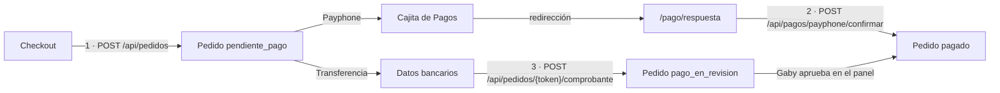

**Convenciones comunes:**

| Convención | Detalle |
|---|---|
| Formato | JSON en UTF-8, salvo la subida del comprobante (`multipart/form-data`). |
| Montos | Enteros en **centavos de dólar (USD)**, igual que en la base de datos y en Payphone. |
| Autenticación | No hay sesión: la compra es sin cuenta. Cada endpoint se protege a su manera: Turnstile e `Idempotency-Key` en el endpoint 1, la verificación directa con Payphone en el 2 y el `token_publico` del pedido en el 3. Los tres tienen límite de solicitudes por IP. |
| Precios | El cliente **nunca envía precios**. La base de datos los recalcula; el cliente solo puede enviar el total que vio, para detectar si cambió. |
| Errores | Cuerpo uniforme `{ codigo, mensaje, detalles[] }`. `codigo` es estable para la lógica del frontend y `mensaje` está listo para mostrarse en español. |
| Límite de solicitudes | Al superarlo se responde `429` con la cabecera `Retry-After`. |

### Especificación OpenAPI

```yaml
openapi: 3.1.0
info:
  title: Quinde Blue — API de la tienda
  version: 0.1.0
  description: >
    Endpoints de servidor (BFF) de la tienda Quinde Blue. Cubren la creación del pedido,
    la confirmación del pago con Payphone y la carga del comprobante de transferencia.
    Todos los montos están en centavos de USD.
servers:
  - url: https://quindeblue.com
    description: Producción (dominio de ejemplo)
  - url: https://staging.quindeblue.com
    description: Staging (Payphone en modo de pruebas)
  - url: http://localhost:4321
    description: Desarrollo local
tags:
  - name: Pedidos
    description: Creación de pedidos a partir del carrito, con precios recalculados en el servidor.
  - name: Pagos
    description: Confirmación de pagos con Payphone y carga de comprobantes de transferencia.

paths:
  /api/pedidos:
    post:
      tags: [Pedidos]
      operationId: crearPedido
      summary: Crea un pedido a partir del carrito y los datos de entrega
      description: >
        Valida el cuerpo con Zod y llama a la función `crear_pedido()` de la base de datos. Esa
        función recalcula precios, recargos, cupón, envío e IVA; valida stock, capacidad y mínimo
        de piezas de cada caja; registra o actualiza al cliente en el CRM, y crea el pedido en
        estado `pendiente_pago`. Según el método de pago, responde con los parámetros para la
        Cajita de Payphone o con los datos bancarios para transferir.
      parameters:
        - name: Idempotency-Key
          in: header
          required: true
          description: >
            UUID generado por el navegador para este intento de compra. Si llega dos veces
            (doble clic o reintento de red), se devuelve el mismo pedido en lugar de crear otro.
          schema:
            type: string
            format: uuid
      requestBody:
        required: true
        content:
          application/json:
            schema:
              $ref: '#/components/schemas/CrearPedidoRequest'
            examples:
              cajaYProducto:
                summary: Un cuaderno personalizado y una caja armada, con envío a Guayaquil
                value:
                  items:
                    - tipo: producto
                      producto_id: 6f1c2a4e-1b7d-4c55-9a43-2f0b9f6f7a11
                      modelo_base_id: 0c9d7e21-3a58-4f0e-b0c4-9e2d6a1b5c33
                      cantidad: 1
                      personalizacion:
                        - opcion_id: 9b2e4f61-7c1a-4d3e-8f50-1a2b3c4d5e6f
                          valor_texto: Sofía
                        - opcion_id: 2d4f6a8c-0e1b-4c3d-9e5f-6a7b8c9d0e1f
                          valor_opcion_id: 7e8f9a0b-1c2d-4e3f-8a4b-5c6d7e8f9a0b
                    - tipo: caja
                      tipo_caja_id: 3a5c7e9b-2d4f-4a6c-8e0b-1d3f5a7c9e2b
                      diseno_caja_id: 8c0e2a4c-6e8a-4c2e-9a4c-6e8a0c2e4a6c
                      diseno_tarjeta_id: 5b7d9f1b-3d5f-4b7d-8f1b-3d5f7b9d1f3b
                      dedicatoria: "Para la mejor profe: gracias por enseñar con tanto cariño."
                      firma: Tus alumnos de 3.º B
                      piezas:
                        - producto_id: 1e3a5c7e-9b1d-4f3a-8c5e-7a9c1e3a5c7e
                          cantidad: 1
                          personalizacion: []
                        - producto_id: 4c6e8a0c-2e4a-4c6e-8a0c-2e4a6c8e0a2c
                          cantidad: 2
                          personalizacion: []
                  contacto:
                    nombre: María Fernanda Ortiz
                    email: mafer.ortiz@example.com
                    telefono: "+593991234567"
                    acepta_marketing: true
                  entrega:
                    metodo: envio
                    es_regalo: true
                    destinatario:
                      nombre: Lucía Mendoza
                      telefono: "+593987654321"
                    direccion:
                      ciudad_id: a1b2c3d4-e5f6-4a7b-8c9d-0e1f2a3b4c5d
                      direccion_principal: Av. Francisco de Orellana 234 y Justino Cornejo
                      referencia: Edificio blanco junto a la farmacia, piso 3
                    fecha_entrega_deseada: "2026-12-18"
                  metodo_pago: payphone
                  cupon: BIENVENIDA10
                  facturacion: null
                  total_mostrado_centavos: 4865
                  turnstile_token: 0.AbCdEfGhIjKlMnOpQrStUvWxYz
      responses:
        '201':
          description: Pedido creado en estado `pendiente_pago`.
          headers:
            Location:
              description: URL de seguimiento del pedido (`/pedido/{token_publico}`).
              schema:
                type: string
          content:
            application/json:
              schema:
                $ref: '#/components/schemas/PedidoCreado'
              examples:
                conPayphone:
                  summary: Respuesta para pagar con Payphone
                  value:
                    codigo: QB-2026-000123
                    token_publico: 2b9f6c1e-8d4a-4f7e-9c3b-5a1d7e9f2c4b
                    estado: pendiente_pago
                    expira_en: "2026-12-10T15:42:00-05:00"
                    totales:
                      subtotal_centavos: 4850
                      descuento_centavos: 485
                      envio_centavos: 500
                      base_imponible_centavos: 4230
                      iva_centavos: 635
                      tasa_iva: 15
                      total_centavos: 4865
                    pago:
                      metodo: payphone
                      payphone:
                        clientTransactionId: QB-2026-000123
                        amount: 4865
                        amountWithTax: 4230
                        amountWithoutTax: 0
                        tax: 635
                        currency: USD
                        reference: Pedido QB-2026-000123 · Quinde Blue
        '400':
          $ref: '#/components/responses/ErrorValidacion'
        '403':
          description: El token de Turnstile no es válido (posible bot).
          content:
            application/json:
              schema:
                $ref: '#/components/schemas/Error'
              example:
                codigo: CAPTCHA_INVALIDO
                mensaje: No pudimos verificar que eres una persona. Vuelve a intentarlo.
                detalles: []
        '409':
          description: >
            El pedido no se puede crear con los datos actuales: el total cambió respecto del que
            vio el cliente, o un producto se agotó o dejó de estar disponible.
          content:
            application/json:
              schema:
                $ref: '#/components/schemas/Error'
              example:
                codigo: PRECIO_CAMBIADO
                mensaje: El total de tu pedido cambió. Revisa el nuevo total antes de pagar.
                detalles:
                  - campo: total_mostrado_centavos
                    valor_esperado: 4865
                    valor_actual: 5115
        '422':
          description: Una regla de negocio impide el pedido.
          content:
            application/json:
              schema:
                $ref: '#/components/schemas/Error'
              example:
                codigo: CAPACIDAD_CAJA_EXCEDIDA
                mensaje: Las piezas elegidas no caben en la caja mediana. Prueba con la caja grande.
                detalles:
                  - campo: items[1].piezas
                    espacios_usados: 7
                    capacidad: 6
        '429':
          $ref: '#/components/responses/DemasiadasSolicitudes'

  /api/pagos/payphone/confirmar:
    post:
      tags: [Pagos]
      operationId: confirmarPagoPayphone
      summary: Confirma con Payphone un pago y lo registra en el pedido
      description: >
        La página `/pago/respuesta` lo llama con los parámetros `id` y `clientTransactionId` que
        Payphone agrega al redirigir. El servidor confirma la transacción con la API de Payphone
        (con el token de la tienda, dentro de los 5 minutos que Payphone exige) y llama a
        `registrar_pago()`. Esa función exige `statusCode` 3, verifica que el monto coincida con
        el total del pedido y evita registrar dos veces la misma transacción. Es idempotente:
        repetir la llamada devuelve el mismo resultado sin registrar nada nuevo.
      requestBody:
        required: true
        content:
          application/json:
            schema:
              $ref: '#/components/schemas/ConfirmarPagoRequest'
            example:
              id: 28473615
              clientTransactionId: QB-2026-000123
      responses:
        '200':
          description: >
            Payphone respondió y el resultado quedó registrado. `resultado` indica si el pago fue
            aprobado o cancelado por el comprador.
          content:
            application/json:
              schema:
                $ref: '#/components/schemas/ConfirmacionPago'
              examples:
                aprobado:
                  summary: Pago aprobado
                  value:
                    resultado: aprobado
                    codigo_pedido: QB-2026-000123
                    estado_pedido: pagado
                    token_publico: 2b9f6c1e-8d4a-4f7e-9c3b-5a1d7e9f2c4b
                    pago:
                      monto_centavos: 4865
                      marca_tarjeta: Visa
                      ultimos_digitos: "4242"
                      codigo_autorizacion: W1234567
                      fecha: "2026-12-10T15:14:09-05:00"
                    whatsapp_url: https://wa.me/593990000000?text=Hola%20Gaby%2C%20acabo%20de%20pagar%20el%20pedido%20QB-2026-000123
                cancelado:
                  summary: El comprador canceló en la Cajita
                  value:
                    resultado: cancelado
                    codigo_pedido: QB-2026-000123
                    estado_pedido: pendiente_pago
                    token_publico: 2b9f6c1e-8d4a-4f7e-9c3b-5a1d7e9f2c4b
                    pago: null
                    whatsapp_url: null
        '400':
          $ref: '#/components/responses/ErrorValidacion'
        '404':
          $ref: '#/components/responses/PedidoNoEncontrado'
        '409':
          description: >
            Payphone aprobó un monto distinto al del pedido. El pago se registra como `rechazado`
            para conciliarlo y se alerta a la administradora; el pedido no se marca como pagado.
          content:
            application/json:
              schema:
                $ref: '#/components/schemas/Error'
              example:
                codigo: MONTO_NO_COINCIDE
                mensaje: Hubo un problema con el monto del pago. Ya avisamos a Quinde Blue y te contactaremos.
                detalles: []
        '410':
          description: >
            Venció el plazo de confirmación de Payphone y la transacción se revirtió. El pedido
            sigue pendiente y el comprador puede volver a intentar el pago.
          content:
            application/json:
              schema:
                $ref: '#/components/schemas/Error'
              example:
                codigo: PAGO_EXPIRADO
                mensaje: El pago no se completó a tiempo y no se realizó ningún cobro. Puedes intentarlo de nuevo.
                detalles: []
        '429':
          $ref: '#/components/responses/DemasiadasSolicitudes'
        '502':
          description: >
            Payphone no respondió. La página muestra "verificando tu pago" y reintenta
            automáticamente mientras siga dentro del plazo de confirmación.
          content:
            application/json:
              schema:
                $ref: '#/components/schemas/Error'
              example:
                codigo: PROVEEDOR_NO_DISPONIBLE
                mensaje: Estamos verificando tu pago con Payphone. No cierres esta página.
                detalles: []

  /api/pedidos/{token}/comprobante:
    post:
      tags: [Pagos]
      operationId: subirComprobante
      summary: Sube el comprobante de una transferencia bancaria
      description: >
        Guarda el archivo en el bucket privado `comprobantes`, crea un pago `en_revision` y pasa
        el pedido a `pago_en_revision`. Gaby lo aprueba o lo rechaza desde el panel. Si se
        rechaza, el pedido vuelve a `pendiente_pago` y el comprador puede subir otro comprobante
        con este mismo endpoint. El `token_publico` del pedido, que no se puede adivinar, sirve
        como autorización.
      parameters:
        - name: token
          in: path
          required: true
          description: '`token_publico` del pedido, recibido al crearlo y en el correo de confirmación.'
          schema:
            type: string
            format: uuid
      requestBody:
        required: true
        content:
          multipart/form-data:
            schema:
              type: object
              required: [archivo]
              properties:
                archivo:
                  type: string
                  format: binary
                  description: Imagen JPG o PNG, o PDF, de máximo 5 MB.
            encoding:
              archivo:
                contentType: image/jpeg, image/png, application/pdf
      responses:
        '201':
          description: Comprobante recibido. El pedido queda en revisión.
          content:
            application/json:
              schema:
                $ref: '#/components/schemas/ComprobanteRecibido'
              example:
                codigo_pedido: QB-2026-000124
                estado_pedido: pago_en_revision
                pago:
                  id: d4e5f6a7-b8c9-4d0e-9f1a-2b3c4d5e6f7a
                  estado: en_revision
                  creado_en: "2026-12-10T16:03:27-05:00"
                mensaje: Recibimos tu comprobante. Te avisaremos por correo cuando Gaby lo confirme.
        '404':
          $ref: '#/components/responses/PedidoNoEncontrado'
        '409':
          description: >
            El pedido no admite comprobantes: se paga con Payphone, ya está pagado, ya tiene un
            comprobante en revisión o expiró.
          content:
            application/json:
              schema:
                $ref: '#/components/schemas/Error'
              example:
                codigo: ESTADO_PEDIDO_INVALIDO
                mensaje: Este pedido ya tiene un comprobante en revisión.
                detalles: []
        '413':
          description: El archivo supera los 5 MB.
          content:
            application/json:
              schema:
                $ref: '#/components/schemas/Error'
              example:
                codigo: ARCHIVO_DEMASIADO_GRANDE
                mensaje: El archivo pesa más de 5 MB. Sube una foto o PDF más liviano.
                detalles: []
        '415':
          description: >
            El tipo de archivo no está permitido. El servidor revisa el contenido real del archivo,
            no solo su extensión.
          content:
            application/json:
              schema:
                $ref: '#/components/schemas/Error'
              example:
                codigo: TIPO_ARCHIVO_INVALIDO
                mensaje: Solo aceptamos imágenes JPG o PNG, o archivos PDF.
                detalles: []
        '429':
          $ref: '#/components/responses/DemasiadasSolicitudes'

components:
  schemas:
    CrearPedidoRequest:
      type: object
      additionalProperties: false
      required: [items, contacto, entrega, metodo_pago, turnstile_token]
      properties:
        items:
          type: array
          minItems: 1
          maxItems: 20
          items:
            oneOf:
              - $ref: '#/components/schemas/ItemProducto'
              - $ref: '#/components/schemas/ItemCaja'
            discriminator:
              propertyName: tipo
              mapping:
                producto: '#/components/schemas/ItemProducto'
                caja: '#/components/schemas/ItemCaja'
        contacto:
          $ref: '#/components/schemas/Contacto'
        entrega:
          $ref: '#/components/schemas/Entrega'
        metodo_pago:
          type: string
          enum: [payphone, transferencia]
        cupon:
          type: [string, 'null']
          maxLength: 40
          description: Código del cupón. No distingue mayúsculas.
        facturacion:
          oneOf:
            - $ref: '#/components/schemas/Facturacion'
            - type: 'null'
          description: '`null` significa consumidor final.'
        total_mostrado_centavos:
          type: integer
          minimum: 0
          description: >
            Total que el cliente vio en pantalla. Si no coincide con el recalculado, se responde
            409 `PRECIO_CAMBIADO` para que lo confirme antes de pagar.
        turnstile_token:
          type: string
          description: Token de Cloudflare Turnstile generado en el checkout.

    ItemProducto:
      type: object
      additionalProperties: false
      required: [tipo, producto_id, cantidad]
      properties:
        tipo:
          type: string
          const: producto
        producto_id:
          type: string
          format: uuid
        modelo_base_id:
          type: [string, 'null']
          format: uuid
          description: Obligatorio si el producto es personalizable.
        cantidad:
          type: integer
          minimum: 1
          maximum: 20
        personalizacion:
          type: array
          maxItems: 10
          items:
            $ref: '#/components/schemas/Personalizacion'

    ItemCaja:
      type: object
      additionalProperties: false
      required: [tipo, tipo_caja_id, diseno_caja_id, piezas]
      properties:
        tipo:
          type: string
          const: caja
        tipo_caja_id:
          type: string
          format: uuid
        diseno_caja_id:
          type: string
          format: uuid
        diseno_tarjeta_id:
          type: [string, 'null']
          format: uuid
          description: '`null` significa que la caja va sin tarjeta.'
        dedicatoria:
          type: [string, 'null']
          maxLength: 500
          description: >
            Mensaje que Gaby escribe a mano. El límite efectivo es el `max_caracteres` de la
            tarjeta elegida (300 por defecto). Vacío significa tarjeta en blanco.
        firma:
          type: [string, 'null']
          maxLength: 80
        piezas:
          type: array
          minItems: 1
          maxItems: 30
          items:
            $ref: '#/components/schemas/PiezaCaja'

    PiezaCaja:
      type: object
      additionalProperties: false
      required: [producto_id, cantidad]
      properties:
        producto_id:
          type: string
          format: uuid
          description: Debe ser un producto con `habilitado_caja = true`.
        modelo_base_id:
          type: [string, 'null']
          format: uuid
        cantidad:
          type: integer
          minimum: 1
          maximum: 10
        personalizacion:
          type: array
          maxItems: 10
          items:
            $ref: '#/components/schemas/Personalizacion'

    Personalizacion:
      type: object
      additionalProperties: false
      required: [opcion_id]
      description: Se envía `valor_opcion_id` para las opciones de selección o color, y `valor_texto` para las de texto.
      properties:
        opcion_id:
          type: string
          format: uuid
        valor_opcion_id:
          type: string
          format: uuid
        valor_texto:
          type: string
          minLength: 1
          maxLength: 120
      oneOf:
        - required: [valor_opcion_id]
        - required: [valor_texto]

    Contacto:
      type: object
      additionalProperties: false
      required: [nombre, email, telefono]
      properties:
        nombre:
          type: string
          minLength: 2
          maxLength: 120
        email:
          type: string
          format: email
          maxLength: 254
        telefono:
          type: string
          pattern: '^\+593\d{8,9}$'
          description: Número de WhatsApp en formato E.164 de Ecuador.
        acepta_marketing:
          type: boolean
          default: false
          description: Consentimiento explícito para recibir promociones (LOPDP).

    Entrega:
      type: object
      additionalProperties: false
      required: [metodo]
      properties:
        metodo:
          type: string
          enum: [envio, retiro]
        es_regalo:
          type: boolean
          default: false
        destinatario:
          type: object
          additionalProperties: false
          description: Solo si `es_regalo` es verdadero. Si no, recibe la persona de contacto.
          required: [nombre, telefono]
          properties:
            nombre:
              type: string
              minLength: 2
              maxLength: 120
            telefono:
              type: string
              pattern: '^\+593\d{8,9}$'
        direccion:
          type: object
          additionalProperties: false
          required: [ciudad_id, direccion_principal, referencia]
          properties:
            ciudad_id:
              type: string
              format: uuid
            direccion_principal:
              type: string
              minLength: 5
              maxLength: 200
            referencia:
              type: string
              minLength: 3
              maxLength: 200
        fecha_entrega_deseada:
          type: [string, 'null']
          format: date
        notas:
          type: [string, 'null']
          maxLength: 500
      allOf:
        - if:
            properties:
              metodo:
                const: envio
          then:
            required: [direccion]
        - if:
            properties:
              es_regalo:
                const: true
            required: [es_regalo]
          then:
            required: [destinatario]

    Facturacion:
      type: object
      additionalProperties: false
      required: [tipo_identificacion, identificacion, razon_social, email]
      properties:
        tipo_identificacion:
          type: string
          enum: [cedula, ruc, pasaporte]
        identificacion:
          type: string
          minLength: 5
          maxLength: 20
        razon_social:
          type: string
          maxLength: 200
        email:
          type: string
          format: email

    Totales:
      type: object
      required: [subtotal_centavos, descuento_centavos, envio_centavos, base_imponible_centavos, iva_centavos, tasa_iva, total_centavos]
      properties:
        subtotal_centavos:
          type: integer
        descuento_centavos:
          type: integer
        envio_centavos:
          type: integer
        base_imponible_centavos:
          type: integer
        iva_centavos:
          type: integer
        tasa_iva:
          type: number
          description: Porcentaje aplicado, tomado de `configuracion_tienda`.
        total_centavos:
          type: integer
          description: subtotal − descuento + envío = base imponible + IVA.

    PedidoCreado:
      type: object
      required: [codigo, token_publico, estado, expira_en, totales, pago]
      properties:
        codigo:
          type: string
          description: Código legible del pedido. También es el `clientTransactionId` de Payphone.
        token_publico:
          type: string
          format: uuid
        estado:
          type: string
          const: pendiente_pago
        expira_en:
          type: string
          format: date-time
        totales:
          $ref: '#/components/schemas/Totales'
        pago:
          oneOf:
            - $ref: '#/components/schemas/InstruccionesPayphone'
            - $ref: '#/components/schemas/InstruccionesTransferencia'
          discriminator:
            propertyName: metodo
            mapping:
              payphone: '#/components/schemas/InstruccionesPayphone'
              transferencia: '#/components/schemas/InstruccionesTransferencia'

    InstruccionesPayphone:
      type: object
      required: [metodo, payphone]
      description: >
        Parámetros para mostrar la Cajita de Pagos. El `token` y el `storeId` de Payphone no
        viajan en esta respuesta: la tienda los tiene en su configuración pública, por diseño
        del proveedor.
      properties:
        metodo:
          type: string
          const: payphone
        payphone:
          type: object
          required: [clientTransactionId, amount, amountWithTax, amountWithoutTax, tax, currency, reference]
          properties:
            clientTransactionId:
              type: string
              maxLength: 50
            amount:
              type: integer
              description: Igual a amountWithTax + amountWithoutTax + tax.
            amountWithTax:
              type: integer
            amountWithoutTax:
              type: integer
            tax:
              type: integer
            currency:
              type: string
              const: USD
            reference:
              type: string
              maxLength: 100

    InstruccionesTransferencia:
      type: object
      required: [metodo, cuentas, plazo_horas, url_comprobante]
      properties:
        metodo:
          type: string
          const: transferencia
        cuentas:
          type: array
          items:
            type: object
            required: [banco, tipo_cuenta, numero, titular, identificacion]
            properties:
              banco:
                type: string
              tipo_cuenta:
                type: string
                enum: [ahorros, corriente]
              numero:
                type: string
              titular:
                type: string
              identificacion:
                type: string
        plazo_horas:
          type: integer
          description: Horas para subir el comprobante antes de que el pedido expire.
        url_comprobante:
          type: string
          description: Ruta del endpoint para subir el comprobante de este pedido.

    ConfirmarPagoRequest:
      type: object
      additionalProperties: false
      required: [id, clientTransactionId]
      properties:
        id:
          type: integer
          format: int64
          description: Identificador de la transacción en Payphone (parámetro `id` de la redirección).
        clientTransactionId:
          type: string
          maxLength: 50
          description: Código del pedido (parámetro `clientTransactionId` de la redirección).

    ConfirmacionPago:
      type: object
      required: [resultado, codigo_pedido, estado_pedido, token_publico]
      properties:
        resultado:
          type: string
          enum: [aprobado, cancelado]
        codigo_pedido:
          type: string
        estado_pedido:
          type: string
          enum: [pagado, pendiente_pago]
        token_publico:
          type: string
          format: uuid
          description: Para enlazar a la página de seguimiento del pedido.
        pago:
          oneOf:
            - type: 'null'
            - type: object
              required: [monto_centavos, marca_tarjeta, ultimos_digitos, codigo_autorizacion, fecha]
              properties:
                monto_centavos:
                  type: integer
                marca_tarjeta:
                  type: string
                ultimos_digitos:
                  type: string
                  pattern: '^\d{4}$'
                codigo_autorizacion:
                  type: string
                fecha:
                  type: string
                  format: date-time
        whatsapp_url:
          type: [string, 'null']
          format: uri
          description: Enlace a WhatsApp con el código del pedido ya escrito (F7).

    ComprobanteRecibido:
      type: object
      required: [codigo_pedido, estado_pedido, pago, mensaje]
      properties:
        codigo_pedido:
          type: string
        estado_pedido:
          type: string
          const: pago_en_revision
        pago:
          type: object
          required: [id, estado, creado_en]
          properties:
            id:
              type: string
              format: uuid
            estado:
              type: string
              const: en_revision
            creado_en:
              type: string
              format: date-time
        mensaje:
          type: string

    Error:
      type: object
      required: [codigo, mensaje, detalles]
      properties:
        codigo:
          type: string
          description: Código estable para la lógica del frontend.
          enum:
            - VALIDACION
            - CAPTCHA_INVALIDO
            - PRODUCTO_NO_DISPONIBLE
            - CAPACIDAD_CAJA_EXCEDIDA
            - MINIMO_PIEZAS_NO_ALCANZADO
            - DEDICATORIA_DEMASIADO_LARGA
            - CUPON_INVALIDO
            - CIUDAD_SIN_COBERTURA
            - PRECIO_CAMBIADO
            - PEDIDO_NO_ENCONTRADO
            - ESTADO_PEDIDO_INVALIDO
            - MONTO_NO_COINCIDE
            - PAGO_EXPIRADO
            - PROVEEDOR_NO_DISPONIBLE
            - ARCHIVO_DEMASIADO_GRANDE
            - TIPO_ARCHIVO_INVALIDO
            - DEMASIADAS_SOLICITUDES
        mensaje:
          type: string
          description: Mensaje en español, listo para mostrar al comprador.
        detalles:
          type: array
          items:
            type: object
            additionalProperties: true
            properties:
              campo:
                type: string
                description: Ruta del campo afectado, por ejemplo `items[1].piezas`.

  responses:
    ErrorValidacion:
      description: El cuerpo no cumple el esquema.
      content:
        application/json:
          schema:
            $ref: '#/components/schemas/Error'
          example:
            codigo: VALIDACION
            mensaje: Revisa los datos marcados.
            detalles:
              - campo: contacto.telefono
                problema: Debe ser un número de Ecuador, por ejemplo +593991234567.
    PedidoNoEncontrado:
      description: No existe un pedido con ese código o token.
      content:
        application/json:
          schema:
            $ref: '#/components/schemas/Error'
          example:
            codigo: PEDIDO_NO_ENCONTRADO
            mensaje: No encontramos este pedido.
            detalles: []
    DemasiadasSolicitudes:
      description: Se superó el límite de solicitudes para esta IP.
      headers:
        Retry-After:
          description: Segundos que hay que esperar antes de reintentar.
          schema:
            type: integer
      content:
        application/json:
          schema:
            $ref: '#/components/schemas/Error'
          example:
            codigo: DEMASIADAS_SOLICITUDES
            mensaje: Hiciste demasiados intentos. Espera un momento y vuelve a intentarlo.
            detalles: []
```

### Notas sobre cada endpoint

**1. `POST /api/pedidos`**
- **Cómo se llega al total del ejemplo:**

  | Concepto | Centavos |
  |---|---|
  | Cuaderno A5 personalizado (1.800 + 200 por el nombre) | 2.000 |
  | Caja mediana (800 + 150 por la tarjeta) | 950 |
  | Cuaderno mini | 900 |
  | Marcapáginas de madera (500 × 2) | 1.000 |
  | **Subtotal** | **4.850** |
  | Cupón del 10 % | −485 |
  | Envío a la zona Costa | 500 |
  | **Total** | **4.865** |

  El IVA ya está incluido en los precios: el total se desglosa en 4.230 de base imponible y 635 de IVA al 15 %, que es lo que recibe Payphone. Los montos son ilustrativos.
- **Orden de validación:** primero el esquema (400), luego Turnstile (403), luego las reglas de negocio en `crear_pedido()` (422) y por último la comparación con `total_mostrado_centavos` (409). El pedido solo se crea si todo pasa, en una sola transacción.
- **CRM:** si el correo ya existe, el pedido se asocia a ese cliente, pero **la respuesta no revela** si el correo era conocido. Así no se pueden descubrir los correos de los clientes.

**2. `POST /api/pagos/payphone/confirmar`**
- La redirección de Payphone puede repetirse, por ejemplo si el comprador recarga la página. Por eso el endpoint es idempotente: si el pago ya estaba registrado, devuelve el mismo resultado.
- El comprador solo ve los últimos cuatro dígitos y la marca de la tarjeta; ningún otro dato de la tarjeta pasa por Quinde Blue.

**3. `POST /api/pedidos/{token}/comprobante`**
- El archivo se guarda con un nombre generado (`comprobantes/{pedido_id}/{uuid}.{ext}`), nunca con el nombre original. Gaby lo ve en el panel con un enlace firmado de corta duración.
- Al recibirlo, se envía un correo a la administradora para que valide la transferencia.

---

## 5. Historias de Usuario

Las tres historias cubren el núcleo del MVP: armar una caja de regalo (la funcionalidad diferencial), comprar sin chat ni cuenta (el objetivo principal del producto) y que Gaby pueda publicar sola (la condición para que la tienda se mantenga viva).

**Convenciones:**

- **Formato:** *Como [persona], quiero [acción], para [beneficio]*, con contexto, criterios de aceptación en formato **Dado / Cuando / Entonces** (Gherkin), reglas de negocio, lo que queda fuera de alcance, dependencias y una métrica de éxito.
- **Criterio INVEST:** cada historia es independiente, negociable, valiosa, estimable, pequeña y verificable. La historia 2 supera el tamaño de un sprint, así que se divide en tres sub-historias.
- **Estimación** en puntos de historia (escala Fibonacci) y **prioridad** con MoSCoW (*Must, Should, Could, Won't*).

**Personas:**

| Persona | Descripción |
|---|---|
| **Mafer, compradora** | 28 años, Guayaquil. Sigue a @quinde.blue en Instagram y compra regalos desde el celular. Quiere algo personal y bonito, pero no quiere esperar respuestas por chat durante días. |
| **Gaby, dueña y administradora** | Diseñadora y fundadora de Quinde Blue, mamá de dos. Maneja sola el taller, las redes y las ventas. Usa el panel desde su laptop y no programa. |

**Definición de terminado (común a las tres historias):**
- [ ] Se cumplen todos los criterios de aceptación.
- [ ] Hay tests unitarios del motor de precios y de los esquemas, tests de base de datos y RLS con pgTAP, y un test E2E del recorrido principal con Playwright, según la sección 2.6.
- [ ] Funciona en móvil (375 px) y en escritorio, y se puede usar con teclado y lector de pantalla (WCAG 2.1 AA).
- [ ] Pasa la CI (lint, tipos, tests, Lighthouse) y tiene el pull request revisado.
- [ ] Está desplegada en staging y validada por Gaby.

---

### Historia de Usuario 1 — Armar una caja de regalo

> **Como** Mafer, compradora que busca un regalo para su profesora,
> **quiero** armar una caja eligiendo yo las piezas, la caja y la dedicatoria, y ver el precio a medida que la armo,
> **para** regalar algo personal sin tener que cotizarlo por chat.

| Campo | Valor |
|---|---|
| Funcionalidad | F12 · Crea tu propia caja de regalo |
| Prioridad | **Must** (es el diferencial de la tienda) |
| Estimación | 8 puntos |
| Dependencias | Tablas `tipos_caja`, `disenos_caja`, `disenos_tarjeta`, `productos` (`habilitado_caja`, `espacios_caja`) y `ocasiones` · motor de precios de `packages/shared` · `POST /api/pedidos` con ítems de tipo `caja` |

**Contexto:** hoy cada caja de regalo se cotiza pieza por pieza en el chat, lo que alarga la venta y le quita tiempo a Gaby. El configurador toma como referencia el *Build a Box* de Happy Box, adaptado a productos propios y personalizables.

**Criterios de aceptación:**

```gherkin
Escenario: Ver solo las piezas que se pueden incluir
  Dado que estoy en "Crea tu propia caja"
  Cuando filtro por la ocasión "Día del Maestro"
  Entonces veo solo productos publicados, habilitados para caja, con stock y asociados a esa ocasión
  Y cada pieza muestra foto, nombre, precio y cuántos espacios ocupa

Escenario: El subtotal y los espacios se actualizan al instante
  Dado que elegí la caja mediana, con capacidad para 6 espacios
  Cuando agrego 2 marcapáginas de madera de $5,00 que ocupan 1 espacio cada uno
  Entonces el panel de la caja muestra las 2 piezas, "2 de 6 espacios" y el subtotal actualizado
  Y un lector de pantalla anuncia el nuevo subtotal

Escenario: No se puede superar la capacidad de la caja
  Dado que mi caja mediana tiene 6 de 6 espacios ocupados
  Cuando intento agregar otra pieza
  Entonces la pieza no se agrega
  Y veo el mensaje "Tu caja está llena" con la opción de cambiar a la caja grande

Escenario: Cambiar a una caja más pequeña en la que no caben las piezas
  Dado que tengo 7 espacios ocupados en una caja grande
  Cuando elijo la caja mediana, con capacidad para 6 espacios
  Entonces el cambio no se aplica y veo cuántos espacios debo liberar

Escenario: Personalizar solo las piezas que lo admiten
  Dado que agregué un cuaderno mini personalizable y un marcapáginas que no lo es
  Cuando llego al paso "Personaliza las piezas"
  Entonces solo se me piden los campos del cuaderno mini (modelo base y nombre)
  Y no puedo avanzar sin completar los campos obligatorios
  Y el recargo de la personalización se suma al subtotal

Escenario: Dedicatoria con límite de caracteres o tarjeta en blanco
  Dado que elegí una tarjeta con un límite de 300 caracteres
  Cuando escribo la dedicatoria
  Entonces veo un contador de caracteres restantes y no puedo superar el límite
  Y puedo marcar "Enviar la tarjeta en blanco" o elegir no incluir tarjeta

Escenario: Revisar y agregar la caja al carrito
  Dado que completé todos los pasos y mi caja cumple el mínimo de piezas
  Cuando llego a "Revisa tu caja"
  Entonces veo la vista previa con todas las piezas y el desglose: piezas, personalizaciones, caja y tarjeta
  Y al pulsar "Agregar al carrito" la caja aparece como una sola línea que puedo volver a editar

Escenario: No perder la caja si se recarga la página
  Dado que estoy armando una caja
  Cuando recargo la página o vuelvo más tarde desde el mismo navegador
  Entonces la caja sigue como la dejé

Escenario: Una pieza se agota mientras armo la caja
  Dado que tengo en mi caja una pieza que se acaba de agotar
  Cuando avanzo de paso o voy al carrito
  Entonces veo un aviso que me pide quitarla o reemplazarla antes de pagar
```

**Reglas de negocio:**
- Solo entran productos propios marcados como habilitados para caja.
- La suma de `espacios_caja × cantidad` no puede superar la capacidad de la caja, y la caja debe tener al menos `min_piezas`.
- El precio que se ve en pantalla es informativo: el precio que se cobra lo recalcula `crear_pedido()` en la base de datos.
- En el celular, el panel de la caja es una barra inferior desplegable con el subtotal y el botón "Siguiente".

**Fuera de alcance (fase 2):** varias cajas en un mismo pedido, tarjeta con logo para pedidos corporativos y cajas sugeridas por ocasión.

**Métrica de éxito:** al menos el 40 % de las cajas iniciadas llegan al carrito, y la mediana de tiempo para armar una caja es menor a 4 minutos.

---

### Historia de Usuario 2 — Comprar sin cuenta con un checkout simple

> **Como** Mafer, que llega desde Instagram y compra desde el celular,
> **quiero** pagar mi pedido en una sola página, sin crear una cuenta y sin llenar formularios largos,
> **para** terminar la compra en pocos minutos sin tener que escribirle a nadie antes.

| Campo | Valor |
|---|---|
| Funcionalidades | F5 · Carrito y pago en línea · F6 · Envío o retiro · F7 · Chat posterior a la compra |
| Prioridad | **Must** (es el objetivo principal del producto) |
| Estimación | 13 puntos. Se divide en **2a** Contacto y entrega (5), **2b** Pago con Payphone (5) y **2c** Pago por transferencia (3). |
| Dependencias | Los tres endpoints de la sección 4 · tablas `pedidos`, `pagos`, `clientes`, `ciudades` y `zonas_envio` · Cloudflare Turnstile · SMTP |

**Contexto:** hoy el 90 % de los pagos son por transferencia y todo se coordina por chat, con compras que tardan hasta semanas. La entrevista dejó claro que el cliente desconfía de comprar solo con clics: el contacto humano se mantiene, pero después del pago (F7).

**Criterios de aceptación:**

```gherkin
# 2a · Contacto y entrega
Escenario: Comprar sin cuenta ni contraseña
  Dado que tengo productos en el carrito
  Cuando voy al checkout
  Entonces veo una sola página con tres bloques: Contacto, Entrega y Pago
  Y en ningún momento se me pide crear una cuenta ni una contraseña

Escenario: Formulario mínimo para envío a domicilio
  Dado que elijo "Envío a domicilio" y el pedido no es un regalo
  Entonces los campos obligatorios son como máximo 7: nombre, correo, teléfono, provincia, ciudad, dirección y referencia
  Y la provincia y la ciudad se eligen de listas, no se escriben

Escenario: Retiro en persona
  Cuando elijo "Retiro en persona"
  Entonces desaparecen los campos de dirección
  Y veo la dirección de retiro y el costo de envío en $0,00

Escenario: Enviar a otra persona
  Cuando activo "Es un regalo para otra persona"
  Entonces aparecen solo dos campos más: nombre y teléfono de quien recibe

Escenario: Ver el costo de envío antes de pagar
  Cuando elijo la ciudad "Guayaquil"
  Entonces veo el costo de envío de su zona y los días estimados de entrega
  Y el total del pedido se actualiza

Escenario: Corregir errores sin perder lo escrito
  Dado que escribí el teléfono "0991234567"
  Cuando salgo del campo
  Entonces el teléfono se normaliza a +593991234567 o veo un error en español junto al campo
  Y nada de lo que ya escribí se borra

Escenario: Cliente recurrente
  Dado que ya compré antes con mi correo
  Cuando pulso "¿Ya compraste? Recibe un código" e ingreso el código que llegó a mi correo
  Entonces puedo elegir una de mis direcciones guardadas
  Y si no verifico el código, la tienda no revela ningún dato asociado a mi correo

Escenario: El total cambió antes de pagar
  Dado que el precio de un producto cambió mientras estaba en el checkout
  Cuando pulso "Pagar"
  Entonces veo el nuevo total y debo confirmarlo antes de continuar

# 2b · Pago con Payphone
Escenario: Pago con tarjeta aprobado
  Dado que elegí pagar con tarjeta y completé el checkout
  Cuando pulso "Pagar" y pago en la Cajita de Payphone sin salir de la tienda
  Entonces veo la confirmación con el código del pedido, el resumen y el botón "Escríbenos por WhatsApp"
  Y recibo un correo con el enlace de seguimiento de mi pedido

Escenario: Pago cancelado o vencido
  Dado que cancelé el pago en la Cajita o venció el plazo de confirmación
  Entonces veo "Tu pago no se completó y no se realizó ningún cobro"
  Y puedo volver a intentarlo sin llenar el formulario de nuevo

Escenario: No crear pedidos duplicados
  Cuando pulso "Pagar" dos veces seguidas o se reintenta por un problema de red
  Entonces se crea un solo pedido

# 2c · Pago por transferencia
Escenario: Pagar por transferencia y subir el comprobante después
  Dado que elegí pagar por transferencia
  Cuando confirmo el pedido
  Entonces veo los datos bancarios, el total y un plazo de 48 horas para subir el comprobante
  Y puedo subirlo en ese momento o más tarde desde el enlace de mi correo
  Y al subirlo, mi pedido pasa a "Pago en revisión"
```

**Reglas de negocio:**
- Los datos de facturación son opcionales y van en un bloque colapsado. Por defecto, la factura se emite como consumidor final.
- El cupón es un campo opcional y colapsado; no interrumpe el flujo.
- La casilla para recibir promociones viene desmarcada (LOPDP).
- La Cajita de Payphone se muestra dentro de la página. La confirmación se hace siempre en el servidor (sección 4, endpoint 2).

**Fuera de alcance:** cuentas con contraseña, cálculo de envío con la API de Servientrega (se usan tarifas por zona) y pagos en cuotas.

**Métrica de éxito:** al menos el 60 % de quienes inician el checkout completan el pago, la mediana de tiempo en el checkout es menor a 3 minutos y baja el número de chats previos a la compra.

---

### Historia de Usuario 3 — Publicar una página de producto desde el panel

> **Como** Gaby, dueña de Quinde Blue,
> **quiero** crear y publicar la página de un producto desde el panel, armándola con bloques y viéndola antes de publicarla,
> **para** mantener el catálogo al día sin depender de un programador ni redesplegar el sitio.

| Campo | Valor |
|---|---|
| Funcionalidades | F2 · Ficha de producto · F3 · Personalizador · F4 · Exploración interactiva · F10 · Panel de administración |
| Prioridad | **Must** (sin esto, la tienda depende de un desarrollador) |
| Estimación | 8 puntos |
| Dependencias | Tablas `productos`, `producto_medios`, `modelos_base`, `opciones_personalizacion`, `valores_opcion` y `paginas` · función `publicar_contenido()` · `/api/revalidar` · Supabase Storage · catálogo de bloques de `packages/shared` |

**Contexto:** Gaby ya tiene fotos y videos propios de todos sus productos, y quiere un catálogo curado de unos 20 productos. El benchmark de fichas de producto de marcas artesanales (20 de octubre de 2026) mostró tres oportunidades: solo 1 de 10 marcas tiene una barra de compra fija en el celular, ninguna permite hojear el interior del producto y la línea con el plazo de elaboración junto al precio da confianza.

**Criterios de aceptación:**

```gherkin
Escenario: Crear el producto con sus datos básicos
  Dado que inicié sesión en el panel con MFA
  Cuando creo un producto con nombre, categoría, precio, días de elaboración, materiales y medidas
  Entonces se guarda como borrador y no aparece en la tienda
  Y la URL se genera a partir del nombre, puedo editarla y no se puede repetir

Escenario: Subir y ordenar fotos y videos
  Cuando arrastro fotos (JPG, PNG o WebP de hasta 10 MB) o videos (MP4 de hasta 50 MB)
  Entonces se suben, puedo ordenarlos arrastrándolos y marcar una foto como portada
  Y cada medio exige un texto alternativo antes de publicar

Escenario: Configurar la personalización
  Dado que marqué el producto como personalizable
  Cuando agrego modelos base y opciones como "Color de portada", "Nombre" o "Tipo de hojas"
  Entonces puedo definir los valores y el recargo de cada uno
  Y el panel no me deja tener más de 10 modelos base activos

Escenario: Armar la página con bloques
  Dado que abro el editor de la página del producto
  Entonces veo una plantilla inicial con bloques en un orden recomendado:
    portada con precio y plazo de elaboración, galería, visor interactivo, descripción, preguntas frecuentes y botón "Personalizar"
  Y puedo agregar, editar, reordenar arrastrando o eliminar bloques del catálogo disponible
  Y los cambios se guardan solos como borrador sin afectar lo publicado

Escenario: Ver la página antes de publicarla
  Cuando pulso "Vista previa"
  Entonces veo la página tal como se verá en la tienda, en vista de celular y de escritorio
  Y en el celular aparece la barra de compra fija con el precio y el botón "Personalizar"

Escenario: Revisión antes de publicar
  Dado que a mi producto le falta la portada o el texto alternativo de alguna foto
  Cuando intento publicar
  Entonces veo una lista de lo que falta y el botón "Publicar" queda deshabilitado hasta completarlo

Escenario: Publicar sin redesplegar
  Dado que el producto cumple todos los requisitos
  Cuando pulso "Publicar"
  Entonces en menos de 1 minuto el producto aparece en la tienda y en su categoría
  Y queda registrado en la auditoría quién lo publicó y cuándo

Escenario: Editar un producto ya publicado
  Dado que el producto está publicado
  Cuando cambio la descripción en el editor
  Entonces la tienda sigue mostrando la versión publicada
  Y puedo elegir "Publicar cambios" o "Descartar cambios"

Escenario: Retirar un producto
  Cuando archivo un producto publicado
  Entonces desaparece de la tienda, de su categoría y del configurador de cajas
  Y los pedidos anteriores que lo incluyen no cambian
  Y su antigua URL muestra "Este producto ya no está disponible" con sugerencias de la misma categoría

Escenario: Habilitar el producto para cajas de regalo
  Cuando marco "Disponible para cajas" sin indicar cuántos espacios ocupa
  Entonces el panel no me deja guardar hasta que lo indique
```

**Reglas de negocio:**
- Solo una persona con rol de administradora y MFA activo puede crear, editar o publicar (RLS, sección 2.5).
- Los bloques disponibles son predefinidos: portada, galería, texto, visor interactivo, preguntas frecuentes, botón "Personalizar" y testimonios. Cada uno se valida con su esquema Zod.
- Las imágenes se optimizan automáticamente al servirlas; Gaby no necesita redimensionarlas.

**Fuera de alcance:** cambiar colores y tipografías desde el panel, visor 3D, programar la publicación para una fecha (llega con los lanzamientos, fase 2) e historial de versiones.

**Métrica de éxito:** en una prueba de usabilidad, Gaby publica un producto completo (fotos, personalización y página) en menos de 15 minutos y sin ayuda.

---

## 6. Tickets de Trabajo

Los tres tickets salen de las historias de la sección 5 y siguen el orden en que se desarrollan: primero la base de datos, luego el backend que la usa y por último la interfaz.

| Ticket | Tipo | Historia | Qué entrega |
|---|---|---|---|
| **QB-12** | Base de datos | HU1 · HU2a | Tablas de pedidos y la función `crear_pedido()`, que valida y calcula todo el pedido. |
| **QB-21** | Backend | HU2b | Endpoint de confirmación de pagos con Payphone. |
| **QB-34** | Frontend | HU1 | Isla interactiva "Crea tu propia caja". |

**Convenciones de los tickets:**
- **Ramas:** `tipo/QB-XX-descripcion-corta`, por ejemplo `feat/QB-12-crear-pedido`.
- **Commits:** formato *Conventional Commits* con el ID del ticket, por ejemplo `feat(db): crear_pedido valida capacidad de cajas [QB-12]`.
- **Estimación:** puntos de historia y horas de referencia.
- **Definición de terminado:** la misma de la sección 5, más lo específico de cada ticket.

---

### Ticket 1 — QB-12 · Tablas de pedidos y función `crear_pedido()`

| Campo | Valor |
|---|---|
| Tipo | Base de datos |
| Historias | HU1 · Armar una caja de regalo · HU2a · Contacto y entrega |
| Prioridad | Crítica: sin esta función no se pueden crear pedidos (`POST /api/pedidos`) ni confirmar pagos (QB-21) |
| Estimación | 5 puntos (unas 12 horas) |
| Rama | `feat/QB-12-crear-pedido` |
| Etiquetas | `database`, `supabase`, `pedidos`, `seguridad` |
| Depende de | Migraciones previas del catálogo y de las cajas (`productos`, `modelos_base`, `opciones_personalizacion`, `tipos_caja`, `disenos_caja`, `disenos_tarjeta`) y de clientes y envíos (`clientes`, `ciudades`, `zonas_envio`, `configuracion_tienda`) |

**Objetivo:** crear las tablas del pedido y una función de base de datos que reciba el carrito, lo valide por completo y cree el pedido con precios calculados en el servidor. Es la única forma de crear pedidos: el navegador nunca envía precios (secciones 2.5 y 4).

**Alcance:**

| Incluye | No incluye |
|---|---|
| Tipos `estado_pedido`, `metodo_entrega`, `metodo_pago`, `tipo_item` y `estado_pago` | Validación de cupones: llega con la función `aplicar_cupon()`, junto con las promociones de la fase 2 |
| Tablas `pedidos`, `pedido_items`, `pedido_item_opciones` y `pagos`, con sus restricciones e índices (sección 3.2) | La función `registrar_pago()`, que registra el resultado de un pago y se desarrolla aparte |
| Secuencia para el código legible del pedido | La tarea programada (`pg_cron`) que expira los pedidos vencidos y devuelve su stock |
| Función `crear_pedido()` con validaciones, cálculo de totales e IVA, y reserva de stock | El endpoint HTTP `POST /api/pedidos` que llama a esta función |
| Políticas RLS de las cuatro tablas | |
| Tests pgTAP y regeneración de tipos TypeScript | |

**Archivos:**

```
supabase/migrations/20261103120000_pedidos_tablas.sql       # tipos, tablas, índices, secuencia, RLS
supabase/migrations/20261103120100_fn_crear_pedido.sql      # función crear_pedido() y permisos
supabase/tests/pedidos/crear_pedido.test.sql                # tests pgTAP
supabase/seed.sql                                            # agregar 1 caja, 3 piezas y 2 ciudades de prueba
packages/shared/src/database.types.ts                        # regenerado con supabase gen types
```

**Detalle técnico:**

1. **Firma y permisos:**
   ```sql
   create function public.crear_pedido(p_payload jsonb, p_idempotency_key uuid)
   returns jsonb
   language plpgsql security definer set search_path = '' as $$ ... $$;

   revoke execute on function public.crear_pedido(jsonb, uuid) from public, anon, authenticated;
   grant execute on function public.crear_pedido(jsonb, uuid) to service_role;
   ```
   Solo la ejecuta el BFF con la clave secreta. `p_payload` tiene la forma de `CrearPedidoRequest` (sección 4), ya validada con Zod.

2. **Pasos, todos dentro de una sola transacción:**
   1. **Idempotencia:** si ya existe un pedido con `idempotency_key = p_idempotency_key`, devolver ese pedido sin crear nada.
   2. **Configuración:** leer `configuracion_tienda` (tasa de IVA, si los precios incluyen IVA, plazos de expiración).
   3. **Cliente:** buscar el cliente por correo (`citext`) o crearlo con `origen = 'web'`. Completar el teléfono solo si estaba vacío. Si `acepta_marketing` es verdadero, guardar el consentimiento y la fecha; nunca desmarcar un consentimiento previo desde el checkout.
   4. **Productos sueltos:** el producto debe estar publicado y tener stock (o ser bajo pedido). El modelo base debe pertenecer al producto y estar activo; es obligatorio si el producto es personalizable. Cada opción debe ser del producto, las obligatorias deben estar presentes y los textos no pueden superar `max_caracteres`. Precio de la línea = precio base + recargos de modelo, opciones y valores.
   5. **Cajas:** el tipo de caja, el diseño y la tarjeta deben estar activos. Cada pieza debe tener `habilitado_caja = true`, con las mismas validaciones del paso 4. La suma de `espacios_caja × cantidad` no puede superar `capacidad_espacios`, el número de piezas debe llegar a `min_piezas` y la dedicatoria no puede superar el `max_caracteres` de la tarjeta.
   6. **Envío:** si es envío, la ciudad debe estar activa y su zona define el costo. Si es retiro, el costo es 0.
   7. **Totales:** subtotal, descuento (0 hasta que existan los cupones), envío y total. Si los precios incluyen IVA: `base = round(total / (1 + tasa / 100))` e `iva = total − base`.
   8. **Precio cambiado:** si viene `total_mostrado_centavos` y no coincide con el total calculado, cancelar con `PRECIO_CAMBIADO`, indicando ambos valores.
   9. **Stock:** bloquear las filas con `select … for update` y descontar el stock de los productos que lo controlan.
   10. **Insertar:** crear el pedido con el código `'QB-' || año || '-' || lpad(nextval('pedido_codigo_seq')::text, 6, '0')` y `expira_en` según el método de pago. Luego las líneas (las piezas enlazadas a su caja con `item_padre_id`) y las opciones, todo con copias de nombres y precios.
   11. **Respuesta:** devolver un `jsonb` con `codigo`, `token_publico`, `estado`, `expira_en`, `totales` y los parámetros de pago (sección 4, `PedidoCreado`).

3. **Errores de negocio:** se lanzan con `raise exception using errcode = 'P0001', message = '<CODIGO>', detail = '<json>'`. El BFF traduce `message` al código de error de la API y `detail` al arreglo `detalles`. Códigos: `PRODUCTO_NO_DISPONIBLE`, `CAPACIDAD_CAJA_EXCEDIDA`, `MINIMO_PIEZAS_NO_ALCANZADO`, `DEDICATORIA_DEMASIADO_LARGA`, `CIUDAD_SIN_COBERTURA`, `PRECIO_CAMBIADO` y `VALIDACION`.

4. **RLS:**
   - Visitantes y clientes sin cuenta: sin acceso directo a las cuatro tablas.
   - Cliente con cuenta: lectura de sus propios pedidos (`cliente_id` vinculado a `auth.uid()`).
   - Administradora (`es_admin()`): lectura y actualización del estado. No se permite borrar.

**Criterios de aceptación:**
- [ ] Las migraciones se aplican sin errores sobre una base vacía (`supabase db reset`) y sobre la de staging.
- [ ] Un pedido válido con un producto suelto y una caja de 3 piezas devuelve los totales correctos, incluido el desglose de IVA.
- [ ] Repetir la llamada con la misma `p_idempotency_key` devuelve el mismo pedido y no descuenta stock dos veces.
- [ ] Cada regla del paso 5 rechaza el pedido con su código de error y no deja filas a medias.
- [ ] Un precio manipulado en el payload no tiene efecto, porque la función ignora cualquier precio recibido.
- [ ] Los roles `anon` y `authenticated` no pueden ejecutar la función ni insertar directamente en las tablas.
- [ ] La función responde en menos de 300 ms con 20 líneas, medido con `explain analyze` en local.

**Tests pgTAP (`supabase test db`):**

| # | Caso | Resultado esperado |
|---|---|---|
| 1 | Pedido válido con producto y caja | Pedido creado, totales e IVA correctos |
| 2 | Misma clave de idempotencia dos veces | Mismo `codigo`, stock descontado una sola vez |
| 3 | Piezas que superan la capacidad de la caja | `CAPACIDAD_CAJA_EXCEDIDA` |
| 4 | Caja con menos piezas que el mínimo | `MINIMO_PIEZAS_NO_ALCANZADO` |
| 5 | Pieza no habilitada para caja | `PRODUCTO_NO_DISPONIBLE` |
| 6 | Producto sin stock o en borrador | `PRODUCTO_NO_DISPONIBLE` |
| 7 | Dedicatoria más larga que el límite de la tarjeta | `DEDICATORIA_DEMASIADO_LARGA` |
| 8 | Ciudad inactiva | `CIUDAD_SIN_COBERTURA` |
| 9 | `total_mostrado_centavos` distinto | `PRECIO_CAMBIADO` con ambos valores |
| 10 | Precio incluido en el payload | Se ignora; se cobra el precio de la base de datos |
| 11 | Ejecución como `anon` o `authenticated` | Permiso denegado |
| 12 | Cliente con cuenta lee pedidos de otro cliente | 0 filas |

**Notas:** documentar en el pull request el plan de reversión de la migración. Las tablas son nuevas, así que se pueden eliminar sin afectar datos existentes.

---

### Ticket 2 — QB-21 · Endpoint de confirmación de pagos con Payphone

| Campo | Valor |
|---|---|
| Tipo | Backend |
| Historia | HU2b · Pago con Payphone |
| Prioridad | Crítica: sin esto no se puede cobrar con tarjeta |
| Estimación | 3 puntos (unas 8 horas) |
| Rama | `feat/QB-21-confirmar-payphone` |
| Etiquetas | `backend`, `pagos`, `payphone`, `seguridad` |
| Depende de | QB-12 (tablas de pedidos) · función `registrar_pago()`, que valida el estado, el monto y la idempotencia antes de marcar el pedido como pagado · credenciales de Payphone en modo de pruebas |

**Objetivo:** implementar `POST /api/pagos/payphone/confirmar` según la sección 4. El endpoint confirma la transacción con Payphone dentro de los 5 minutos que exige el proveedor, registra el resultado con `registrar_pago()` y devuelve lo que la página `/pago/respuesta` necesita para mostrar la confirmación.

**Alcance:**

| Incluye | No incluye |
|---|---|
| Endpoint con validación Zod, límite de solicitudes y manejo de errores | La página `/pago/respuesta`, que muestra el resultado al comprador (trabajo de frontend) |
| Cliente de Payphone con tiempo de espera y tipos | La función `registrar_pago()` (trabajo de base de datos) |
| Correo de confirmación al comprador | La plantilla visual del correo con la identidad de la marca; aquí se usa una versión simple en texto |
| Tests de integración con Payphone simulado | |

**Archivos:**

```
apps/tienda/src/pages/api/pagos/payphone/confirmar.ts   # endpoint
apps/tienda/src/lib/payphone.ts                         # cliente de la API de confirmación
apps/tienda/src/lib/errores.ts                          # traducción de errores de la base de datos a respuestas HTTP
apps/tienda/src/lib/correo.ts                           # envío por SMTP (Nodemailer)
packages/shared/src/schemas/pagos.ts                    # ConfirmarPagoRequest y ConfirmacionPago (Zod)
apps/tienda/tests/api/confirmar-payphone.test.ts        # tests de integración
```

**Detalle técnico:**

1. **Validar** el cuerpo con `ConfirmarPagoRequest`: `id` entero y `clientTransactionId` de hasta 50 caracteres. Si no es válido, responder 400 `VALIDACION`.
2. **Limitar solicitudes:** como máximo 10 por minuto por IP; al superarlo, 429 con `Retry-After`.
3. **Buscar el pedido** por `codigo = clientTransactionId` con el cliente de servidor de Supabase. Si no existe, 404 `PEDIDO_NO_ENCONTRADO`.
4. **Atajo idempotente:** si el pedido ya está `pagado` con un pago aprobado de ese mismo `payphone_transaction_id`, devolver 200 `aprobado` **sin volver a llamar a Payphone**.
5. **Confirmar con Payphone:**
   ```ts
   // lib/payphone.ts
   export async function confirmarTransaccion(id: number, clientTxId: string): Promise<RespuestaPayphone> {
     const res = await fetch(`${PAYPHONE_API}/api/confirm`, {
       method: "POST",
       headers: { Authorization: `Bearer ${env.PAYPHONE_TOKEN}`, "Content-Type": "application/json" },
       body: JSON.stringify({ id, clientTxId }),
       signal: AbortSignal.timeout(8000),
     });
     // ...
   }
   ```
6. **Interpretar la respuesta:**

   | Respuesta de Payphone | Acción | Respuesta del endpoint |
   |---|---|---|
   | `statusCode` 3 (aprobado) | `registrar_pago()` → pedido `pagado` | 200 `aprobado` |
   | `statusCode` 3, pero `registrar_pago()` detecta un monto distinto | Pago registrado como `rechazado`, correo de alerta a la administradora | 409 `MONTO_NO_COINCIDE` |
   | `statusCode` 2 (cancelado) | Pago registrado como `cancelado`; el pedido sigue pendiente | 200 `cancelado` |
   | Error de Payphone por transacción vencida o revertida | Pago registrado como `revertido` | 410 `PAGO_EXPIRADO` |
   | Tiempo de espera agotado, error de red o 5xx | No se registra nada | 502 `PROVEEDOR_NO_DISPONIBLE` (la página reintenta) |

7. **Después de aprobar:** enviar el correo de confirmación con el enlace `/pedido/{token_publico}` sin bloquear la respuesta. Un fallo del correo se registra en el log, pero no cambia la respuesta. Armar `whatsapp_url` con el número de `configuracion_tienda` y un mensaje que incluya el código del pedido.
8. **Registro (logs):** guardar `codigo`, `payphone_transaction_id`, `statusCode` y duración. **Nunca** registrar el token de Payphone ni la respuesta completa en los logs del servidor; la respuesta completa queda solo en `pagos.respuesta_proveedor`.

**Variables de entorno:** `PAYPHONE_TOKEN`, `PAYPHONE_API` (URL base, distinta en pruebas y producción), `SUPABASE_SERVICE_ROLE_KEY`, `SMTP_*`. Se agregan a `.env.example` sin valores reales.

**Criterios de aceptación:**
- [ ] Un pago aprobado en el modo de pruebas de Payphone deja el pedido en `pagado`, crea un pago `aprobado` con marca, últimos cuatro dígitos y código de autorización, y envía el correo.
- [ ] Llamar dos veces al endpoint con los mismos datos devuelve el mismo resultado, crea un solo registro de pago y hace una sola llamada a Payphone.
- [ ] Un monto distinto al del pedido nunca marca el pedido como pagado.
- [ ] Si Payphone no responde en 8 segundos, el endpoint responde 502 en menos de 10 segundos.
- [ ] Los errores siguen el formato `{ codigo, mensaje, detalles }` y los mensajes están en español.
- [ ] El token de Payphone no aparece en ningún log, respuesta ni archivo del repositorio.

**Tests de integración (Vitest + MSW para simular Payphone):**

| # | Caso | Resultado esperado |
|---|---|---|
| 1 | Payphone aprueba | 200 `aprobado`, pedido `pagado`, correo enviado |
| 2 | Payphone cancela | 200 `cancelado`, pedido `pendiente_pago` |
| 3 | Monto distinto al del pedido | 409 `MONTO_NO_COINCIDE`, alerta a la administradora |
| 4 | Payphone tarda más de 8 s | 502 `PROVEEDOR_NO_DISPONIBLE`, sin registros |
| 5 | Segunda llamada tras un pago aprobado | 200 `aprobado`, sin llamar a Payphone |
| 6 | Código de pedido inexistente | 404 `PEDIDO_NO_ENCONTRADO` |
| 7 | Cuerpo inválido | 400 `VALIDACION` |
| 8 | 11 solicitudes en un minuto desde la misma IP | La undécima recibe 429 |
| 9 | Falla el envío del correo | 200 `aprobado` igualmente; el error queda en el log |

**Prueba manual en staging:** un pago aprobado y uno cancelado con la Cajita en modo de pruebas, revisando las transacciones en Payphone Developer. Durante esa prueba hay que confirmar con el proveedor cómo responde la API cuando se confirma una transacción ya vencida, para ajustar el mapeo a 410.

---

### Ticket 3 — QB-34 · Isla interactiva "Crea tu propia caja"

| Campo | Valor |
|---|---|
| Tipo | Frontend |
| Historia | HU1 · Armar una caja de regalo |
| Prioridad | Alta: es la funcionalidad diferencial |
| Estimación | 8 puntos (unas 20 horas) |
| Rama | `feat/QB-34-crea-tu-caja` |
| Etiquetas | `frontend`, `astro`, `react`, `accesibilidad`, `mobile` |
| Depende de | Tablas de cajas y piezas con datos de prueba · motor de precios `calcularCaja()` en `packages/shared` · store del carrito con soporte para líneas de tipo `caja` · wireframes de "Crea tu caja" aprobados |

**Objetivo:** construir la página `/crea-tu-caja` con una isla React que guía al comprador por los cinco pasos de la F12, con el panel de la caja y el subtotal siempre visibles, y que agrega la caja al carrito como una sola línea editable.

**Alcance:**

| Incluye | No incluye |
|---|---|
| Página Astro que carga los datos en el servidor | Varias cajas por pedido (fase 2) |
| Isla con los 5 pasos, el panel de la caja y la vista previa | Cajas sugeridas por ocasión (fase 2) |
| Store persistente de la caja en curso | El checkout (HU2) |
| Edición de una caja ya agregada al carrito | Animaciones 3D de la caja |
| Versión móvil con barra inferior | |
| Tests de componentes y E2E | |

**Archivos:**

```
apps/tienda/src/pages/crea-tu-caja.astro                 # carga del catálogo apto para cajas (SSR)
apps/tienda/src/islands/CreaTuCaja/CreaTuCaja.tsx        # contenedor y navegación entre pasos
apps/tienda/src/islands/CreaTuCaja/PasoPiezas.tsx        # filtro por ocasión y grilla de piezas
apps/tienda/src/islands/CreaTuCaja/PasoPersonalizar.tsx  # campos de las piezas personalizables
apps/tienda/src/islands/CreaTuCaja/PasoCaja.tsx          # tamaño y diseño de la caja
apps/tienda/src/islands/CreaTuCaja/PasoDedicatoria.tsx   # tarjeta, mensaje con contador y firma
apps/tienda/src/islands/CreaTuCaja/PasoRevision.tsx      # vista previa y desglose
apps/tienda/src/islands/CreaTuCaja/PanelCaja.tsx         # panel lateral (escritorio) o barra inferior (móvil)
apps/tienda/src/stores/caja.ts                           # estado de la caja en curso (nanostores, persistente)
apps/tienda/tests/islands/CreaTuCaja.test.tsx            # tests de componentes
tests/e2e/crea-tu-caja.spec.ts                           # recorrido completo en móvil y escritorio
```

**Detalle técnico:**

1. **Datos (SSR):** `crea-tu-caja.astro` consulta en el servidor las piezas publicadas y habilitadas para caja (con stock, espacios, precio, medios, modelos y opciones), los tipos y diseños de caja activos, las tarjetas y las ocasiones. Los pasa como props a la isla, montada con `client:load` porque es el contenido principal de la página.
2. **Estado:** `stores/caja.ts` usa `persistentMap` de `@nanostores/persistent` con la clave `qb-caja-en-curso` y guarda solo identificadores, cantidades, opciones y textos; nunca precios. Expone acciones puras y testeables: `agregarPieza`, `quitarPieza`, `cambiarCantidad`, `elegirCaja`, `personalizar`, `escribirDedicatoria` y `reiniciar`.
3. **Precio y capacidad:** cada cambio recalcula con `calcularCaja()` del paquete compartido, que devuelve el subtotal, el desglose, los espacios usados y los errores. Es la misma lógica que replica `crear_pedido()` en la base de datos.
4. **Reglas en la interfaz:**
   - El botón "Agregar" se deshabilita cuando la pieza no cabe, con el mensaje "Tu caja está llena" y un acceso para cambiar a una caja mayor.
   - No se puede elegir una caja menor si las piezas no caben; se indica cuántos espacios hay que liberar.
   - No se avanza de paso si faltan campos obligatorios; el foco va al primer campo con error.
   - El contador de la dedicatoria usa el `max_caracteres` de la tarjeta elegida.
5. **Validación final:** antes de agregar al carrito, validar con el esquema Zod `ItemCaja` de la sección 4, para que el payload que llegue a `POST /api/pedidos` sea válido.
6. **Carrito:** "Agregar al carrito" crea una línea de tipo `caja` en el store del carrito con un `lineaId` y reinicia la caja en curso. "Editar" desde el carrito abre `/crea-tu-caja?editar={lineaId}` con la caja cargada.
7. **Diseño adaptable:**
   - Desde 1024 px, `PanelCaja` es una columna fija a la derecha.
   - En pantallas menores, es una barra inferior fija con el subtotal, los espacios y "Siguiente", y se despliega como hoja inferior para ver las piezas.
   - El indicador "Paso X de 5" está siempre visible.
8. **Accesibilidad:**
   - El subtotal y los espacios se anuncian con `aria-live="polite"`.
   - Al cambiar de paso, el foco se mueve al título del paso.
   - Todo funciona con teclado, la hoja inferior atrapa el foco mientras está abierta y los controles de cantidad tienen etiquetas accesibles.
9. **Rendimiento:**
   - El JavaScript de la isla pesa como máximo 60 KB comprimido.
   - Las imágenes de las piezas usan `loading="lazy"` y tamaños responsivos.
   - LCP menor a 2,5 s en móvil con 4G simulado.
10. **Estados:** cargando, sin piezas disponibles para la ocasión elegida y pieza agotada (aviso con opción de quitarla).

**Criterios de aceptación:**
- [ ] Se cumplen los 9 escenarios de la HU1 (sección 5).
- [ ] El subtotal de la interfaz coincide con el que calcula `crear_pedido()` en los 10 casos de prueba compartidos del motor de precios.
- [ ] La caja en curso sobrevive a una recarga, y una caja del carrito se puede editar y volver a guardar.
- [ ] Funciona en Chrome Android (375 px), Safari iOS y escritorio.
- [ ] Lighthouse en móvil: rendimiento de 90 o más y accesibilidad de 95 o más; sin errores de axe.
- [ ] El tamaño de la isla está dentro del presupuesto de 60 KB.

**Tests:**

| Tipo | Caso |
|---|---|
| Componentes (Vitest + Testing Library) | Agregar piezas actualiza el subtotal y los espacios · el botón se deshabilita con la caja llena · no se puede cambiar a una caja menor si no caben las piezas · el contador de la dedicatoria respeta el límite · no se avanza con campos obligatorios vacíos · el estado se restaura desde el almacenamiento |
| E2E (Playwright, móvil y escritorio) | Recorrido completo: filtrar por ocasión, agregar 3 piezas, personalizar una, elegir caja, escribir dedicatoria, revisar y agregar al carrito · editar la caja desde el carrito · recargar en mitad del recorrido y continuar |

**Diseño:** se implementa a partir de los wireframes de "Crea tu caja" (sección 1.3, material visual pendiente). Si los wireframes no están listos al iniciar, se acuerda con Gaby una versión provisional con los componentes base de la tienda.

---

## 7. Pull Requests

> Esta entrega es solo documentación, así que todavía no hay pull requests ejecutadas. Esta sección define la plantilla y el flujo de revisión, y documenta las tres pull requests **planificadas** que implementan los tickets de la sección 6. Cuando se abran en GitHub, se completarán con el enlace, la fecha, los comentarios de la revisión y las evidencias.

**Flujo de trabajo:**

| Regla | Detalle |
|---|---|
| Una pull request por ticket | La rama sale de `staging` con el formato `tipo/QB-XX-descripcion` y vuelve a `staging`. |
| Título | *Conventional Commits* con el ID del ticket: `feat(db): ... [QB-12]`. |
| CI obligatoria | Lint, verificación de tipos, tests unitarios, pgTAP, build y Lighthouse deben pasar antes de fusionar (sección 2.4). |
| Revisión | Al menos una aprobación. Los cambios visibles para el comprador o para Gaby se validan además en staging. |
| Fusión | *Squash and merge*, para dejar un commit por ticket en `staging`. |
| Producción | Se pasa de `staging` a `main` con una pull request de versión que agrupa los tickets validados. |

**Plantilla (`.github/pull_request_template.md`):**

```markdown
## Ticket
QB-XX · enlace al ticket · Historia relacionada

## Qué cambia
Resumen en 2 o 3 líneas, y por qué.

## Cambios principales
- ...

## Cómo probar
Pasos y comandos para reproducir en local o en staging.

## Evidencias
Capturas, salida de tests o enlace a la vista previa de staging.

## Checklist
- [ ] Cumple los criterios de aceptación del ticket
- [ ] Tests nuevos o actualizados, y la CI en verde
- [ ] Sin secretos en el código ni en los logs
- [ ] Migraciones reversibles (si aplica)
- [ ] Documentación actualizada (README, OpenAPI, .env.example)

## Riesgos y reversión
Qué puede fallar y cómo se revierte.
```

---

### Pull Request 1 — Tablas de pedidos y función `crear_pedido()`

| Campo | Valor |
|---|---|
| Título | `feat(db): tablas de pedidos y función crear_pedido con validación de cajas [QB-12]` |
| Rama | `feat/QB-12-crear-pedido` → `staging` |
| Ticket | QB-12 · Base de datos · HU1 y HU2a |
| Estado | Planificada |
| Etiquetas | `database`, `supabase`, `seguridad` |

**Qué cambia:** agrega el modelo de pedidos (sección 3) y la función `crear_pedido()`, que se convierte en la única forma de crear un pedido. La función recalcula precios, valida productos, cajas y envío, calcula el IVA y reserva el stock en una sola transacción, así que un pedido nunca queda a medias ni con precios enviados desde el navegador.

**Cambios principales:**
- `supabase/migrations/20261103120000_pedidos_tablas.sql`: cinco tipos enumerados; las tablas `pedidos`, `pedido_items`, `pedido_item_opciones` y `pagos`, con sus CHECK, índices únicos parciales (un solo pago aprobado por pedido) y claves foráneas; la secuencia `pedido_codigo_seq`, y RLS con sus políticas.
- `supabase/migrations/20261103120100_fn_crear_pedido.sql`: la función `crear_pedido(jsonb, uuid)` con `security definer` y `search_path` vacío, ejecutable solo por `service_role`.
- `supabase/tests/pedidos/crear_pedido.test.sql`: 12 tests pgTAP.
- `supabase/seed.sql`: una caja, tres piezas y dos ciudades de prueba.
- `packages/shared/src/database.types.ts`: tipos regenerados.

**Decisiones para revisar:**
- Los errores de negocio se lanzan con `errcode = 'P0001'` y el código en `message`, para que el BFF los traduzca a la API sin interpretar texto libre.
- Se descuenta el stock al crear el pedido (con `select … for update`) y no al pagar. Así se evita vender dos veces la última unidad mientras alguien paga. El stock vuelve cuando el pedido expira, con una tarea programada que se desarrolla aparte.
- La función ignora cualquier campo de precio del payload, en lugar de rechazarlo. La API ya no lo acepta, y así queda una segunda barrera.

**Cómo probar:**
```bash
npm run db:reset    # supabase db reset: aplica migraciones y seed
npm run db:test     # supabase test db: ejecuta los tests pgTAP
```
Ejecutar `crear_pedido()` desde el editor SQL de Supabase local con el payload de ejemplo de la sección 4: debe devolver un total de 4.865 centavos, con 4.230 de base imponible y 635 de IVA.

**Riesgos y reversión:** las tablas son nuevas y ningún código las usa todavía, así que revertir es una migración que elimina la función, las tablas y los tipos (incluida en la descripción de la pull request). Riesgo principal: un error en el cálculo del IVA. Lo cubren los tests 1 y 10, más la comparación con el motor de precios del frontend (QB-34).

---

### Pull Request 2 — Endpoint de confirmación de pagos con Payphone

| Campo | Valor |
|---|---|
| Título | `feat(api): confirmar pagos de Payphone de forma idempotente [QB-21]` |
| Rama | `feat/QB-21-confirmar-payphone` → `staging` |
| Ticket | QB-21 · Backend · HU2b |
| Estado | Planificada; se abre después de fusionar la PR 1 |
| Etiquetas | `backend`, `pagos`, `payphone`, `seguridad` |

**Qué cambia:** agrega `POST /api/pagos/payphone/confirmar` según la especificación OpenAPI de la sección 4. Cuando Payphone devuelve al comprador a la tienda, el servidor confirma la transacción dentro del plazo de 5 minutos, la registra y devuelve el resultado para mostrar la confirmación con el botón de WhatsApp.

**Cambios principales:**
- `apps/tienda/src/pages/api/pagos/payphone/confirmar.ts`: el endpoint, con validación Zod, límite de 10 solicitudes por minuto por IP y la tabla de decisiones según la respuesta de Payphone.
- `apps/tienda/src/lib/payphone.ts`: cliente tipado de la API de confirmación, con un tiempo de espera de 8 segundos.
- `apps/tienda/src/lib/errores.ts`: traducción de los errores de la base de datos al formato `{ codigo, mensaje, detalles }`.
- `apps/tienda/src/lib/correo.ts`: correo de confirmación que no bloquea la respuesta.
- `packages/shared/src/schemas/pagos.ts`: esquemas `ConfirmarPagoRequest` y `ConfirmacionPago`.
- `apps/tienda/tests/api/confirmar-payphone.test.ts`: 9 tests de integración con Payphone simulado (MSW).
- `.env.example`: se agregan `PAYPHONE_TOKEN` y `PAYPHONE_API`, sin valores reales.

**Decisiones para revisar:**
- **Atajo idempotente:** si el pedido ya está pagado con la misma transacción, se responde sin volver a llamar a Payphone. Esto cubre las recargas de la página de respuesta.
- **Un error de red no registra nada:** se responde 502 y la página reintenta mientras dure el plazo. Registrar un pago "fallido" por un problema de red confundiría la conciliación.
- **Logs mínimos:** se registran el código del pedido, el ID de la transacción, el `statusCode` y la duración. La respuesta completa de Payphone se guarda solo en `pagos.respuesta_proveedor`.

**Cómo probar:**
```bash
npm run test -w apps/tienda -- confirmar-payphone   # 9 tests de integración
npm run dev -w apps/tienda                           # tienda local con Payphone en modo de pruebas
```
En staging: hacer un pago aprobado y uno cancelado con la Cajita en modo de pruebas, y revisar que coincidan con las transacciones de Payphone Developer y con la tabla `pagos`.

**Riesgos y reversión:** el endpoint es nuevo y nada depende de él hasta conectar la página `/pago/respuesta`, así que revertir el commit es suficiente. Riesgo abierto: cómo responde Payphone al confirmar una transacción ya vencida. Se verifica en la prueba de staging y, si hace falta, se ajusta el mapeo a 410 en un commit de la misma pull request.

---

### Pull Request 3 — Isla "Crea tu propia caja"

| Campo | Valor |
|---|---|
| Título | `feat(tienda): configurador Crea tu propia caja con subtotal en vivo [QB-34]` |
| Rama | `feat/QB-34-crea-tu-caja` → `staging` |
| Ticket | QB-34 · Frontend · HU1 |
| Estado | Planificada; puede avanzar en paralelo a la PR 2, pero se fusiona después de la PR 1 |
| Etiquetas | `frontend`, `astro`, `react`, `accesibilidad`, `mobile` |

**Qué cambia:** agrega la página `/crea-tu-caja` con una isla React que guía al comprador por los cinco pasos de la F12. El panel de la caja y el subtotal están siempre visibles, y la caja se agrega al carrito como una sola línea editable. Es la funcionalidad diferencial de la tienda (sección 1.2).

**Cambios principales:**
- `apps/tienda/src/pages/crea-tu-caja.astro`: carga en el servidor las piezas habilitadas para caja, los tipos y diseños de caja, las tarjetas y las ocasiones.
- `apps/tienda/src/islands/CreaTuCaja/`: el contenedor, los cinco pasos y `PanelCaja`, que es una columna lateral en escritorio y una barra inferior desplegable en el celular.
- `apps/tienda/src/stores/caja.ts`: la caja en curso, persistente en el navegador, sin precios.
- Integración con el store del carrito para agregar y editar cajas (`/crea-tu-caja?editar={lineaId}`).
- `apps/tienda/tests/islands/CreaTuCaja.test.tsx` y `tests/e2e/crea-tu-caja.spec.ts`: tests de componentes y E2E en móvil y escritorio.

**Decisiones para revisar:**
- La isla se monta con `client:load` y no con `client:idle`, porque es el contenido principal de la página y el comprador interactúa con ella de inmediato.
- El precio se calcula con `calcularCaja()` del paquete compartido. Un test compara sus resultados con los de `crear_pedido()` (PR 1) en 10 casos, para que el subtotal en pantalla y el total cobrado nunca difieran.
- En el celular se usa una barra inferior fija en lugar de un panel lateral. Sigue el patrón de barra de compra fija del benchmark de fichas, que solo 1 de 10 marcas aplica.

**Cómo probar:**
```bash
npm run test -w apps/tienda -- CreaTuCaja           # tests de componentes
npx playwright test tests/e2e/crea-tu-caja.spec.ts  # E2E en móvil y escritorio
npm run dev -w apps/tienda                           # recorrer /crea-tu-caja en local
```
Recorrido manual sugerido: filtrar por "Día del Maestro", llenar la caja mediana hasta el límite, intentar agregar una pieza más, cambiar a la caja grande, personalizar el cuaderno mini, escribir una dedicatoria de 300 caracteres, agregar al carrito, recargar la página y editar la caja desde el carrito.

**Evidencias que se adjuntarán:** capturas en 375 px y 1280 px de cada paso, el informe de Lighthouse en móvil (objetivo: rendimiento de 90 o más y accesibilidad de 95 o más) y el tamaño de la isla dentro del presupuesto de 60 KB.

**Riesgos y reversión:** la página es nueva y solo se enlaza desde el inicio cuando se valida en staging, así que revertir no afecta otras rutas. Riesgo principal: diferencias de redondeo entre el cálculo del frontend y el de la base de datos, cubiertas por el test de comparación.
